# DDA Scattering Pipeline — Project Manual

**Single scattering properties of randomly oriented hydrometeors (ADDA → ARTS SSDB)**

*Version: 2026-11-09 · repo state: Phases 0–8 complete (modernization plan done), Phase 9A
scanned (analytic diffraction-peak model, not yet wired in) — backscatter Mueller export
(`beta_0.9.1`) and NetCDF4 Mueller artifacts live; ARO/TRO backlog ready for HPC production runs*

---

## How to use this manual

This is the single reference document for maintaining and operating the DDA automation
pipeline in this repository. It is written for the **future project maintainer**: enough
physics theory to understand *what* is computed and *why* each knob matters, and enough
operational detail (verified against the actual source, not from memory) to run, extend
and debug the pipeline safely.

- Flowcharts / call graphs are **Mermaid** diagrams — they render on GitHub, in VS Code
  (Markdown preview), and in the generated HTML (`docs/DDA-manual.html`).
- All quantitative plots are **real data** (measured benchmarks, real shape metadata, the
  actual Matzler-2006 implementation). They are regenerated by
  [`make_figures.py`](make_figures.py): `mamba activate DDA && python docs/make_figures.py`
  → `docs/figures/*.png`. If you change the backlog or run new benchmarks, re-run it and
  commit the figures. (The Appendix-E baseline plots are re-rendered by that script
  *delegating* to `baselines/plot_baseline_figs.py`, so the manual can never drift from
  the reference baseline report.)
- Every figure has a **bold *Fig. N* caption line directly below it** stating the one
  thing it proves and how to read it. If you only skim, read the figure captions.
- The browsable HTML version is built with `python docs/build_html.py`
  (add `--pdf` if a headless Chrome/Chromium is installed). Mermaid diagrams in the
  HTML render via mermaid.js from a CDN — same requirement as GitHub.

### Pick your entry point

| You want to… | Read |
|---|---|
| run a job today (local smoke test) | §0.3 status → §3.5 local runbook → §3.2 flowcharts |
| submit the production backlog on an HPC | §3.6 runbook → §4.4 job/cost table → Appendix A CLI tokens |
| understand *what* is computed and why a knob matters | Part 1 (theory), in order §§1.1→1.6 |
| debug a run / extend the pipeline | §2 call graphs → Appendix D gotchas → `plans/DDA-modernization-report.md` |
| validate a change before merging | Part 4 gates + `baselines/` (§4.1) |

### Table of contents

| Part | Content |
|---|---|
| **[0](#part-0--orientation)** | What the project computes, where things live, glossary |
| **[1](#part-1--theory)** | DDA, shape model & resolution scheme, ice dielectric, Mueller matrices, orientation averaging (ARO/TRO), spherical harmonics (+ adaptive grids), mirror symmetry, SSDB format, analytic diffraction-peak model & residual storage |
| **[2](#part-2--architecture--data-flow)** | Call graphs (ARO/TRO), artifact data flow, module status table |
| **[3](#part-3--operations--runbooks)** | Config contract + annotated walkthrough, job flowcharts, local & HPC runbooks, idempotency, env overrides |
| **[4](#part-4--validation--quality-gates)** | Golden baselines, noise-based gates, equivalence suites, backlog status |
| **[A](#appendix-a--adda-command-line-tokens-used)** … **[C](#appendix-c--ssdb-netcdf-layout)** | ADDA CLI tables, input .dat files, NetCDF layout |
| **[D](#appendix-d--gotcha-catalog)** | Catalogue of traps, with bug-fix history |
| **[E](#appendix-e--baseline-simulation-results)** | Golden-baseline case results, Mie validation, cross sections + 3-D scattering-pattern plots |

### The one-minute picture

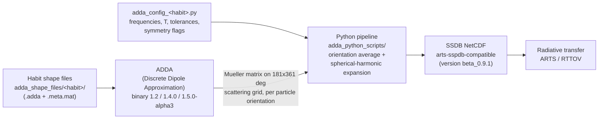

The pipeline answers one question: *for a given particle habit, size, frequency and
temperature, what are its single-scattering properties averaged over all relevant
particle orientations?* Two orientation strategies are produced:

| Strategy | Physical situation | Orientation space covered | Output coordinates |
|---|---|---|---|
| **ARO** — azimuthally random oriented | cloud particle whose symmetry/maximum axis stays **horizontal** (gravity), azimuth fully random | Euler-$\beta$ tilt grid $\times$ incidence-angle grid (5$\times $10 solved, re-gridded to 19$\times $19 in output) | one NetCDF per ( $\beta$, size, f, T) |
| **TRO** — totally random oriented | freely tumbling particle | full Euler space ( $\alpha$, $\beta$, $\gamma$) — integrated away | orientation-independent cross sections + Mueller |

---

## Part 0 — Orientation

### 0.1 Repository map

```
DDA/
├── adda_python_scripts/        ← THE PIPELINE (orchestration, post-processing, export)
│   ├── adda_config_*.py        one config per habit (ALL knobs live here)
│   ├── adda_main_control.py    ARO entry point (T×f×size loop, job submission)
│   ├── adda_sub_control_spharmonics.py   one ARO job: icosphere orientation loop + ADDA
│   ├── adda_main_control_rndorient.py    TRO entry point (chunked job-table)
│   ├── adda_sub_control_randomorient.py  one TRO job: ADDA '-orient avg'
│   ├── adda_process_aro_particles*.py    post-processing (averaging, re-expansion)
│   ├── adda2SSDBnetcdf_functions.py      SSDB export writer
│   ├── definitions_for_netcdf.py         SSDB variable/dimension definitions
│   ├── adda_control_functions.py         (acf) ADDA CLI wrapper, dielectric, mirror transforms
│   ├── adda_orientational_avg_spharmonics_functions.py  (aoa) ARO orientation averaging
│   ├── spherical_harmonics_for_adda.py   (spha) shtns SH expansion machinery
│   ├── icosphere_grid.py       (ico) orientation-sampling grids
│   └── old_configs/, *_for_testing.py, adda_sub_control_gridref.py  ← ARCHIVE, do not extend
├── adda/                       ADDA 1.5.0-alpha3 source (built locally: adda/src/seq/adda)
├── adda_1.4/                   ADDA 1.4.0  ← PRODUCTION BINARY (Phase-3 decision)
├── adda_1.2/                   ADDA 1.2    (golden baselines were made with this)
├── adda_shape_files/           particle geometries: <habit>/Dmax…_Dveq…_Mass…_Freq…GHz.adda(+.meta.mat)
├── adda_aux_input/             avg_params.dat files (TRO '-orient avg' integration control)
├── arts-sspdb-interface/       upstream read-only tooling for the *published* ARTS database
├── plans/                      modernization plan + running findings report (READ before touching code)
├── baselines/                  frozen golden ADDA outputs + regression check tooling
├── analysis/                   phase analysis/gate scripts + benchmark results (JSON/TXT/LOG)
└── docs/                       this manual + figures + build scripts
```

> **Results never live in this repo.** Intermediate and final data go to
> `<prefix_data>/adda_results/…` (cluster) or `<repo>/adda_results/…` (local mode).
> The old HPC results are *not accessible* — regression validation therefore relies on
> `baselines/` (golden ADDA outputs) and the equivalence suites in `analysis/`.

### 0.2 Glossary

| Term | Meaning in this project |
|---|---|
| **ADDA** | *Discrete Dipole Approximation* code (Yurkin & Hoekstra). Three trees in-repo: `adda_1.2`, `adda_1.4` (production), `adda/` (1.5.0-alpha3). |
| **ARO / TRO** | azimuthally random orientation (axis horizontal) / totally random orientation. |
| **D_veq** | volume-equivalent particle diameter; in result-folder names the field is spelled `deq` — and in **TRO** folders it misleadingly carries the equivalent **radius** (legacy, §D-14). |
| **D_max** | maximum particle extent (defines the size grid step naming, e.g. `Dmax00013um`). |
| **size parameter x** | $x=\pi D_{\mathrm{veq}}/\lambda=\pi D_{\mathrm{veq}} f/c_0$; `size_parameter_limit=10` caps the backlog. |
| **dpl / $dpl_{\mathrm{eff}}$** | dipoles per (vacuum) wavelength — DDA resolution. `dpl_eff` is what the fixed shape file actually yields at the requested $\lambda$. ADDA's auto heuristic lands at $dpl_{\mathrm{eff}}$ $\approx$ 18 at production x. |
| **resolution class / fmin** | each physical size exists as several shape files tagged `frequency_min ∈ {192, 337, 457, 671, 887} GHz`; the class decides `N_dipoles` (§1.2). |
| **$\beta$ grid** | tilt of the particle symmetry axis from vertical — the ARO *output* coordinate (19 values in the SSDB grid). Not a solve axis. |
| **incidence angle $\theta_{\mathrm{inc}}$** | direction of the incoming plane wave relative to the *laboratory* z-axis — second ARO output coordinate (19 values). Not a solve axis either: ADDA solves per *icosphere vertex* (§1.5.2). |
| **`-eps` (ADDA)** | iterative-solver stop criterion: residual reduced by $10^{-\texttt{eps}}$. `eps=3` production; noise floor §1.1. |
| **`eps_sphexp`=0.005** | per-vertex spherical-harmonic truncation error of the Mueller grid, relative to RMS of Mueller element $M_{11}$ (§1.6). |
| **`delta`=0.01** | convergence tolerance of the icosphere orientation refinement loop (relative change of the averaged extinction matrices, §1.5.4). |
| **`limit_sph`=4** | max icosphere refinement level (levels: 12/42/162/642/2562 vertices; minimum 3 passes). |
| **shtns** | fast spherical-harmonics transform library (orthonormal, no Condon–Shortley phase here). |
| **Matzler 2006** | dielectric function of ice used for all ice habits: `acf.eps_ice_matzler06(f, T)`. |
| **SSDB** | ARTS Microwave Single Scattering Properties Database; our export format is `beta_0.9` with Phase-6 additive backscatter variables → current writer version `beta_0.9.1` (zenodo 1175572 lineage — Eriksson et al. 2018; ARO extension: Brath et al. 2020). |
| **backscatter matrix $B$ / `backMat_data`** | the exact 4×4 Mueller matrix at the *exact backscatter direction* (grid point Θ=180°, Φ=0° of each ADDA solve) — extracted raw, orientation-averaged and exported **outside** the spherical-harmonic route (Phase 6, §1.4); raw units are k-normalized, exported units m²/sr. |
| **habit IDs** | particle shape definitions from the ARTS habit catalogue: ID9 = Hong/MoCOLAG plate, ID7 = Hong column, ID20 = hexagonal plate aggregate, ID28 = Icon snowflake, ID3 = Liu sector snowflake. |
| **golden / baseline** | frozen ADDA outputs in `baselines/` used for regression (§4.1). |

### 0.3 Status at the time of writing

- **Done (computed + processed):** ARO for `HexPlaAggCrystal_Id20`, `HongPlate_Id9`
  (results on HPC, currently not accessible), plus analytic/voxel verification cases.
- **Backlog ready** (configs verified, jobs counted, not yet run): ARO `HongPlate_Id9`
  full 35-channel grid (5235 jobs), `HongColumn_Id7` (1524), `IconSnow_Id28` (1276),
  `LiuSectorSnowflake_Id3` (1252); TRO `HongPlate_Id9_TOR` (4608 jobs). Estimated
  $\approx 2700$ single-core CPU-h total (see §4.4).
- **Phase 6 done (2026-11-06):** the exact 4×4 **backscatter Mueller matrix** (ADDA
  `mueller_scatgrid` Θ=180°/Φ=0° slice) is extracted per vertex, cached, mirror-filled,
  orientation-averaged and exported as `backMat_data`/`backMat_index` — SSDB writer
  version **beta_0.9.1** (§1.4, §1.8; gate suite `analysis/phase6_backscatter.py`).
- **Phase 7 done (2026-11-06):** the internal per-run Mueller artifact is a single
  **NetCDF4** file `<shape>_mueller_data.nc` (replaces `.pkl`, which replaced ARTS-XML);
  all 12 local legacy artifacts migrated bitwise (§2.3; report §7).
- **Phase 8 done (2026-11-07):** size-parameter-adaptive scattering grid
  (`scatgrid_adaptive=True` config switch — still OFF in production habit configs;
  laws + gate twins in report §8) and export-side SH cap
  (`export_sph_margin=10`, 15× smaller beta files) (§1.6.1).
- **Phase 9A done (2026-11-09):** analytic diffraction-peak model scanned
  (analysis-only): **conditional GO** for a gated model+residual hybrid — big
  spectral savings where the eikonal model is valid (face-on cells), actively
  harmful at grazing incidence. Nothing wired into the pipeline yet (§1.9; report §9).
- **Production ADDA binary: 1.4.0** (locally built; equivalence-gated against 1.2 and
  1.5.0-alpha3, §4.2). Cluster branch configs still default to 1.2 until an MPI 1.4
  build exists there — override with `ADDA_BINARY`/`ADDA_VERSION` (§3.5).
- Before touching **any** pipeline code, read `plans/DDA-modernization-report.md`
  (§1.5 breakages, §1.6 latent-bug catalogue, Phase 2–7 sections list what is deferred).

---

# Part 1 — Theory

## 1.1 The Discrete Dipole Approximation (DDA)

The DDA represents a particle of arbitrary shape as a finite array of **N polarizable
dipoles** sitting on a cubic lattice with spacing *l*. Each dipole acquires a dipole
moment $\mathbf P_i=\boldsymbol\alpha_i\,\mathbf E_{\text{tot}}(\mathbf r_i)$, and the
total field is the incident field plus the field scattered by *all* dipoles — which
yields a dense linear system

$$
\mathbf E_{\text{tot}}(\mathbf r_i)
\;=\; \mathbf E_{\text{inc}}(\mathbf r_i)\;+\;\sum_{j\neq i}\mathbf A_{ij}\,\mathbf P_j,
\qquad i=1,\dots,N
$$

solved iteratively (ADDA default: GMRES stabilized with the Lanczos-type solver
family) rather than by direct factorization. The particle shape is encoded simply by
*which* lattice sites carry dipoles — this is why arbitrary habits (aggregates,
snowflakes, columns) are tractable, and why the whole pipeline can be driven purely from
`*.adda` position files.

What the maintainer must know about ADDA's numerics (all measured in
`analysis/phase4b_adda_benchmark.py`, data in `analysis/phase4b_bench_results.json`,
figure below):

| Fact | Consequence for this project |
|---|---|
| `-eps <n>` = iterative solver stops at residual $10^{-n}$. It controls **solver** error only. | `eps=3` production: own-solver scatter is $\le 10^{-11}$ for small jobs but $\sim 8\cdot10^{-4}$ at $x=5$ — so **identical ADDA re-runs are not bit-reproducible**; every regression gate must be noise-based, never bit-level. |
| Error budget is **discretization-dominated**: at $x=5$ going $dpl_{\text{eff}}$ from 4.5 to 7.5 moves Cext by $2.5\cdot10^{-1}\to$ ref-value, while $\varepsilon_{\text{solver}}$ 4→2 moves it only $\sim1.5\cdot10^{-3}$. | Tuning `-eps` below 3 buys nothing; resolution (the shape file class) is the lever (§1.2). |
| ADDA's auto dpl heuristic lands at **$dpl_{\text{eff}}\approx 18$** at production $x\in(1,8)$. | The fixed per-file dipole counts are deliberately over-resolved; this is a *design choice* (one geometry file reused across all frequencies of its class). |
| Cost per solve: **$N=12\,312$ dipoles → 0.4 s, $N=48\,597$ → 9.5 s** (single core, ADDA 1.4.0, macOS). Scaling $\propto N^{2.3}$. | Backlog cost model §4.4; also why solves are embarrassingly process-level parallel (run N single-core ADDA calls per job, §3.6). |
| Cext/Cabs from a DDA run are only as good as the shape discretization; mirrors/rotations of the *voxel set* are exact lattice operations (§1.7). | Symmetry flags must be verified on the actual voxel set, not on the nominal habit. |

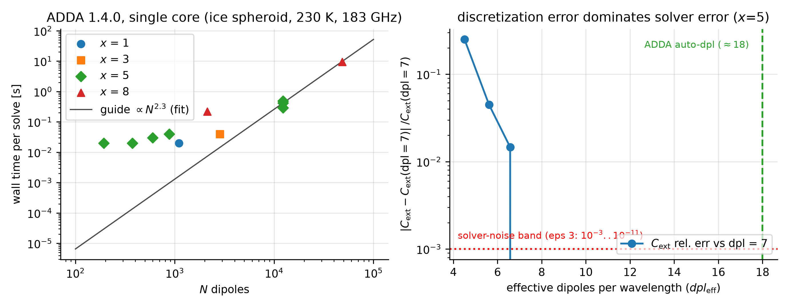

**Fig. 4 — one ADDA solve: cost and error budget.** *Left panel: wall time grows like
$N^{2.3}$ with dipole count — the cost-planning input. Right panel: at $x=5$, the Cext error
from dipole resolution ($dpl_{\mathrm{eff}}$, x-axis) stays 2–3 orders of magnitude ABOVE the
solver-noise band (red dotted line, `-eps 3`): the shape-file resolution class — not `-eps` —
is what sets accuracy. (Data: oblate spheroid 1.0/0.5, Matzler ice 230 K, 183 GHz,
`analysis/phase4b_bench_results.json`.) *

**Key references:** Yurkin & Hoekstra 2011, JQSRT 112, 2234–2247; ADDA manual
`adda/doc/manual.pdf` and `adda_1.2/doc/manual.pdf`.

## 1.2 Particle shape files and the resolution scheme

### Shape model and file contract

Every geometry is a pair of sibling files in `adda_shape_files/<habit>/`:

```
Dmax00013um_Dveq00010um_Mass4.79983e-13kg_Freq0192.000GHz.adda      ← dipole positions (x y z, one per line, lattice units; 1 header line)
Dmax00013um_Dveq00010um_Mass4.79983e-13kg_Freq0192.000GHz.meta.mat  ← MATLAB metadata struct 'meta'
```

The `.meta.mat` (read with `acf.loadmat`) drives *all* size/frequency bookkeeping.
Fields actually consumed by the pipeline: `diameter_vol_eq` [m], `diameter_max` [m],
`frequency_min` [Hz], `N_dipoles`, `mass` [kg], `lambda_dpl` (=$\lambda$ at fmin, m — used to
fill the SSDB `dpl` field), plus provenance (`habit_id`, `source`, `medium`, …).
**A `.adda` without its `.meta.mat` sibling is invisible to the pipeline** (the configs
glob `*.mat` for the size tables).

The model is **cubes on a cubic lattice**. Mirrors map the lattice onto itself — which is
exactly what the symmetry-flag tests of §1.7 exploit. Rotations by non-multiples of 90°
never do, so a voxelized hexagon is *never* an exactly C6-symmetric model; ideal-shape
C6 exists sub-voxel only, and exploiting it would cost a boundary-layer discretization
error. This is why rotation symmetries (`sym_Zobj`) are parked while mirror symmetries
are exploited.

### The 5-resolution scheme

Each physical size ships as several shape files tagged with `frequency_min`:

- classes: **{192, 337, 457, 671, 887} GHz**;
- `N_dipoles` is **fixed per file** — ADDA is *never* asked to resample; it rescales the
  geometry (`-eq_rad`) so the same dipole array represents the particle at any $\lambda$;
- the effective resolution at frequency $f$ is therefore
  $dpl_{\mathrm{eff}} = dpl_{\mathrm{design}}\cdot(f_{\min}/f)$
  — i.e. a file only gets *finer* than designed when used below its fmin.

Two regimes exist in practice (measured on `HongPlate_Id9`, fig. right panel):

| particle | classes | N_dipoles across classes |
|---|---|---|
| small (10 $\mu$m) | 5 | **identical** (1015 in all five — degenerate copies: even the coarsest lattice already exceeds the needed dpl) |
| mid (341 $\mu$m) | 5 | 1258 for classes 192/337/457, then 2740, 6255 |
| large (2596 $\mu$m) | 5 | 27 644$\to $165 072$\to $379 780$\to $1 184 589$\to $2 956 210 ( $\approx$ $f_{\min}^{3}$) |

Also note: **class availability can be per-size incomplete** (e.g. HexPlaAgg 197 $\mu$m has
only the 671 and 887 classes), so never assume five files per size.

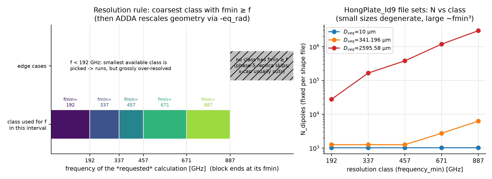

**Fig. 3 — Which shape file computes a given (size, f).** *Left: a requested frequency falls
in one colored block; that block's `fmin` class file does the run (block label sits at its
right edge). The two edge cases are annotated. Right: measured N_dipoles per class for three
real HongPlate sizes — small particles are degenerate (one lattice already suffices), large
ones grow $\\propto f_{\\min}^3$.*

### The selection rule (as implemented in `adda_main_control.py`)

For each (size, f): among the files of that physical size, the code picks the **coarsest
class with fmin $\ge$ f** (`df = fmin−f; df[df<0]=inf; argmin`); every *other* file of that
size prints “wrong particle realisation” and skips. Consequences, precisely:

- f inside a class interval $(\,f_{\min,k-1},\;f_{\min,k}\,]$ → class k computes it ($dpl_{\mathrm{eff}}$ $\ge$ design
  value — always on the safe/over-resolved side);
- **f below all classes** (e.g. the 1–175 GHz entries of the frequency list) → the
  *smallest available class* is picked and the job **does run**, grossly over-resolved;
- **f above all classes** → with `df` all-∞ the raw control code would accidentally pick
  the first file in folder order; the analysis replicas (`phase5_backlog_inventory.py`)
  additionally guard `if not np.isfinite(df).any(): continue`. In production the x-cap
  removes these combinations anyway (HongPlate's 886 GHz < 887 class).
- The size cap: $x=\pi D_{\mathrm{veq}} f/c_0>$ `size_parameter_limit` $(=10)$ → skip (146 of
  HongPlate's 8925 (size,f) combos; the *majority* of combos are killed by resolution
  bookkeeping, not by x — 7701 by the fmin rule; report §1.7).

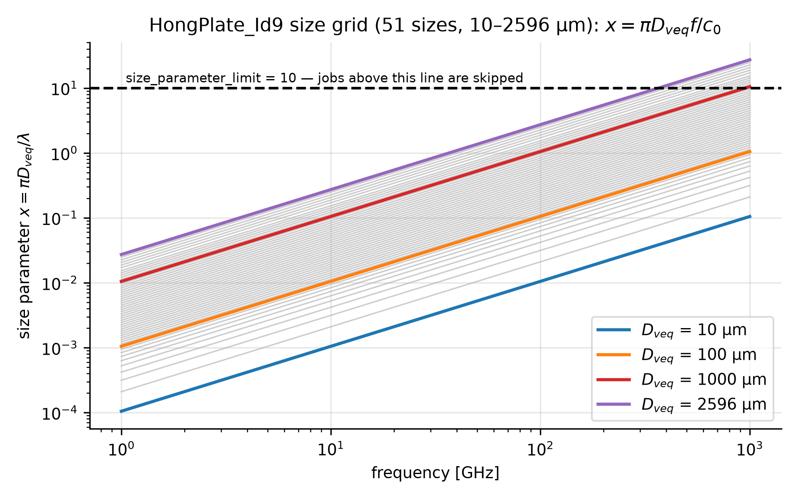

**Fig. 2 — What the x-cap actually removes.** *Each line is one particle size
($x=\\pi D_{veq}f/c_0\\propto Df$, straight in log-log). Everything above the dashed
$x=10$ line is skipped: for HongPlate that is 146 of 8925 (size, f) combinations —
far fewer than the 7701 killed by the resolution rule of Fig. 3.*

## 1.3 Dielectric function of ice (Matzler 2006)

All ice habits use the Mätzler (2006) parametrization, implemented in
`acf.eps_ice_matzler06(f, TK)` (`adda_control_functions.py:1068–1103`):

$$
\varepsilon(f,T) \;=\; 3.1884 + 9.1\cdot10^{-4}\,(T-273)
\;+\; i\left[\frac{\alpha(T)}{f} + \beta(T)\,f\right],
\qquad f\ \text{in GHz},\ T\ \text{in K}
$$

Valid for 0.01–3000 GHz, 20–273.15 K (raises otherwise). **It returns the complex
permittivity, not the refractive index** — callers compute $m=\sqrt{\varepsilon}$ and
hand `-m m_re m_im` to ADDA. Note the absorption is strongly frequency-dependent (loss
$\propto 1/f$ at low $f$, $\propto f$ at high $f$) and strongly temperature-dependent:
the imaginary part at
190 K vs 270 K differs by orders of magnitude — hence the three production temperatures
{190, 230, 270} K are *not* a formality; each (T, f, size) is a separate ADDA job.

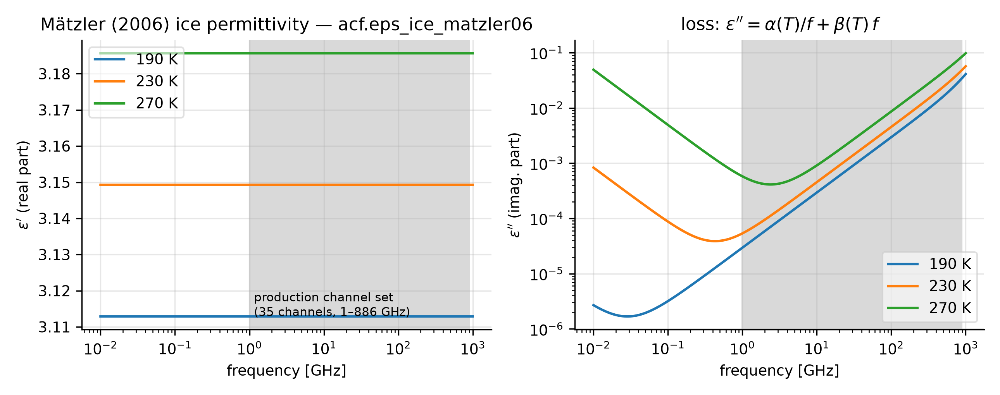


**Fig. 1 — Mätzler ice permittivity across the whole valid range.** *Grey band: the
production channel set (35 frequencies, 1–886 GHz). Reading: the real part (left) barely
moves (≈3.11–3.19, only with T); the imaginary part (right) spans ~4 orders of magnitude
in f and T — the loss tangent at mm/sub-mm wavelengths is what makes cloud ice a
microwave-radiometry issue at all, and why each (T, f) pair is its own ADDA job.*

## 1.4 From ADDA output to Mueller and extinction matrices

Each ADDA solve produces two parsed artifacts (parsing in `acf.adda_call`,
`adda_control_functions.py:198–236` — **positional, column indices hardcoded**; re-verify
when switching ADDA versions, report §1.3):

1. **`ampl_scatgrid`** — the complex *amplitude matrix* S(f̂) on the scattering grid.
   Row 0 = forward direction ( $\theta$=0). Column layout (real/imag pairs) is **not** in
   textbook order:

   | cols | quantity |
   |---|---|
   | 0, 1 | $s_{22}$ |
   | 2, 3 | $s_{11}$ |
   | 4, 5 | $s_{12}$ |
   | 6, 7 | $s_{21}$ |

   From the forward amplitudes the **extinction matrix** ( $4\times4$, units
   $\mu\text{m}^2$) is built via the Mishchenko (2002) optical theorem construction —
   amplitudes scaled by $\lambda/(-2\pi i)$, then $K\cdot=\lambda$
   (`acf.extinction_matrix`, :40–80). *The ARO pipeline's
   C_ext comes entirely from this grid column — which is why `-Csca` and `-alldir_inp`
   were removed from all ARO configs (Phase 3): nothing ever parsed them.*

2. **`mueller_scatgrid`** — the 16 Mueller-matrix elements $M_{11}$…M44 (row-major) on the
   scattering grid from `scat_params.dat`: **181 $\theta$ (0–180°) $\times$ 361 $\varphi$ (0–360°), 1°
   resolution**; col 0 = $\theta$, col 1 = $\varphi$ (degrees). This is the *angular scattering
   signature of one fixed particle orientation* — the object that §1.6 expands in
   spherical harmonics. The $\theta/\varphi$ here live on a grid **attached to the propagation
   direction** — a crucial fact for the mirror transforms of §1.7 ($\theta$ is never remapped).

3. **Backscatter slice (Phase 6)** — from the *same* `mueller_scatgrid`, `acf.adda_call`
   additionally returns
   - `back_matrix`: the 4×4 element vector at **Θ=180°, Φ=0°** (exact backscatter), and
   - `back_mat_ring`: the full Φ ring at Θ=180° (needed for the mirror fill-in and the
     convention analysis, §1.7).

   These are **raw, k-normalized** values (dimensionless $|f|^2$-like — *not* µm²/sr; the
   unit conversion $\lambda^2/4\pi^2$ happens only in `rawdata2average`). `adda_call` raises
   if the scat grid has no Θ=180 row or Φ=0 column — the production 181×361 grid has both.
   This exact-direction matrix travels through the stack **outside** the spherical-harmonic
   route: Brath et al. (2020) flag SH phase functions as unreliable at the exact backscatter
   direction, so the exported `backMat_data` (SSDB, §1.8) is the trustworthy value there.
   The orientation averaging uses `aoa.pol_changer_back` with the convention
   $B_{\mathrm{lab}} = R(+\varphi_{\hat n})\,B_{\mathrm{raw}}\,R(+\varphi_{\hat k})$ — the
   *opposite* rotation sign to the extinction branch (the scattered Stokes basis is attached
   at $-\hat v$; pinned by gate scan, report §6.2: every alternative convention scores ≥31×
   worse).

The two output flags `-scat_matr both` request amplitude + Mueller; `-store_scat_grid` +
`-scat_grid_inp scat_params.dat` request the grid itself. The geometry of *both* angular
coordinate systems — the lab-frame incidence/tilt angles and the propagation-attached
scattering grid — is shown below:

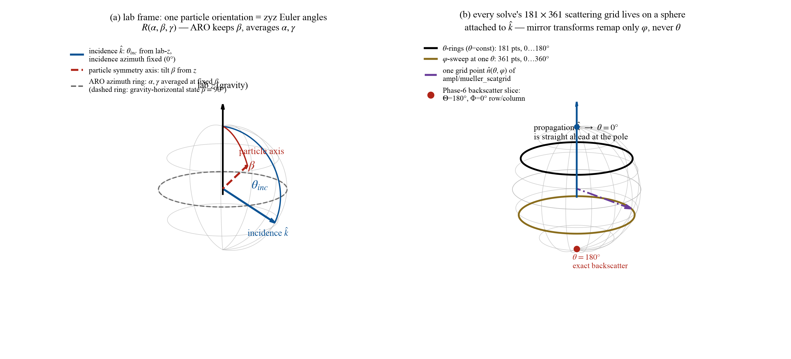

**Fig. 8 — the two coordinate systems you must not confuse.** *(a) lab frame: the incidence
direction $\hat k$ ($\theta_{\mathrm{inc}}$ from lab-$z$, azimuth
fixed) and the particle symmetry axis (tilt $\beta$); ARO averages the azimuth/spin Euler
angles $\alpha,\gamma$ at fixed $\beta$. (b) every solve's $181\times361$ amplitude/Mueller grid
lives on a sphere **attached to $\hat k$** — $\theta=0°$ is the forward pole, and the red pole
($\Theta=180°$, $\Phi=0°$) is the Phase-6 backscatter slice. This is also why the §1.7 mirror
transform remaps only $\varphi$.*

## 1.5 Orientation averaging — the two strategies

### 1.5.1 Why averaging, and in which coordinates

A real cloud contains particles in many orientations. The observed scattering is the
orientation average of the single-particle Mueller matrix. Euler angles are taken in
ADDA's **zyz convention** ( $\alpha$ about lab-$z$, $\beta$ about the line of nodes,
$\gamma$ about the particle's own $z$), i.e.

$$
R(\alpha,\beta,\gamma) \;=\; R_z(\alpha)\;R_{z'}(\beta)\;R_{z''}(\gamma),
\qquad \text{ADDA flag {\tt -orient} } \alpha\ \beta\ \gamma\ \text{[deg]}
$$

> **Source methodology (ARO):** the TRO/ARO classification, the zyz Euler convention, the
> $\alpha$/$\gamma$-averaging at fixed tilt $\beta$, and the resulting ARO dependence on
> ($\beta$, $\theta_{\mathrm{inc}}$, scattering angles) follow **Brath et al. (2020, AMT 13, 2309–2333)**
> — the foundation paper of this project's ARO approach (see References). Their hexagonal-plate /
> plate-aggregate ARO database itself builds on the shape and frequency/temperature setup of
> **Eriksson et al. (2018, ESSD 10, 1301–1326)**, which is also where the habit IDs used in this
> repo (`HongPlate_Id9`, `HongColumn_Id7`, …) originate.

| | ARO | TRO |
|---|---|---|
| free orientation parameters | tilt $\beta$ of the particle axis; azimuth ( $\alpha,\gamma$) averaged | all of $\alpha,\beta,\gamma$ |
| physically motivated state | axis horizontal: $\beta=90^\circ$ (gravity-brained crystals) | freely tumbling particle |
| what is produced | the full grid $\beta\in[0^\circ,180^\circ]$ (19 values) — users weight the tilt distribution downstream | orientation-independent result (integrated inside ADDA) |
| weighting | uniform in $\alpha,\gamma$ at each $\beta$ | uniform over the rotation group |

The SSDB represents the ARO state on a 2-D output grid **( $\beta$, $\theta_{\mathrm{inc}}$)**: $\beta$ = tilt of the
particle axis from vertical (0–180°, 19 output values), $\theta_{\mathrm{inc}}$ = angle between the
incoming plane wave and the lab-z axis (0–180°, 19 output values, azimuth of incidence
fixed to 0 — the remaining azimuthal randomness is what makes it "azimuthally random").
The $\alpha$ and $\gamma$ integrations are performed numerically (Gauss–Legendre) at every
( $\beta$, $\theta_{\mathrm{inc}}$) node.

> **Critical design fact (Phase-4b, report §4b.1):** the $\beta$ and $\theta_{\mathrm{inc}}$ grids are **SSDB
> output coordinates, not quadrature axes**. The number of ADDA *solves* is set solely by
> the icosphere orientation-vertex grid (§1.5.2) — changing `number_of_betas` or the
> incidence-angle resolution does not save or cost ADDA solves. And the tempting
> “half-range reuse” symmetry (solve $\beta$<90° and mirror to $\beta$>90°) is **provably wrong**
> (measured discrepancies $2.3\cdot 10^{-3}$…$7.2\cdot 10^{-2}$ vs $10^{-11}$ solver noise,
> `analysis/phase4b_halfrange_check.py`).

### 1.5.2 ARO sampling: the icosphere vertex grid

One ARO job (one T, f, size) samples particle orientations as the **vertices of a
refined icosahedron** on the unit sphere. A vertex *is* the incidence direction: ADDA is
called with `-prop vx vy vz` (fixed particle attitude `-orient 0 0 0`, beam coming from
the vertex direction). Vertex counts per refinement level $L$:

$$
V(L) = 10\cdot 4^{L}+2 \;:\quad 12,\ 42,\ 162,\ 642,\ 2562,\dots
\qquad(\text{triangles } 20\cdot 4^{L})
$$

per vertex: ADDA solve → parse Mueller grid → SH-expansion (§1.6) → per-vertex NetCDF
cache. The full $\alpha$/$\beta$/$\gamma$ machinery then reconstructs the orientation average by rotating
this vertex-resolved data set (`ico.rotate_vertices` + barycentric interpolation on the
rotated icosphere + Stokes polarization-basis rotation `aoa.pol_changer`).

### 1.5.3 ARO averaging quadrature

Inside `adda_sub_control_spharmonics.py` (:629–814) the **extinction matrix** is averaged
at each $(\beta,\theta_{\mathrm{inc}})$ node with Gauss–Legendre (GL) quadrature in
$\alpha$ and $\gamma$:

$$
n_{\mathrm{GL}} = 4\cdot 2^{L}
\qquad\text{GL nodes mapped to } [-180^\circ,+180^\circ]\text{ in } \alpha \text{ and } \gamma,
$$

for every $\beta$ (from `number_of_betas`, 5) and $\theta_{\mathrm{inc}}$
(`incidence_angles`, 10 values): rotate the vertex set by
$(\alpha,\beta,\gamma)$ → barycentric interpolation of the extinction matrix at the
incidence direction → Stokes polarization-basis rotation → GL-weighted sum over
$\gamma$, then over $\alpha$.

The **Mueller** SH-coefficient averaging happens later, in post-processing
(`aoa.rawdata2average`, joblib-parallel, output re-gridded to the 19$\times $19 SSDB grid).

### 1.5.4 Convergence of the orientation sampling

The icosphere level $L$ is refined until the averaged extinction matrices stop changing:

$$
\varepsilon_{\mathrm{rel}} \;=\;
\frac{\bigl\lVert \overline{K}^{(L)} - \overline{K}^{(L-1)}\bigr\rVert_2}
     {\bigl\lVert \overline{K}^{(L-1)}\bigr\rVert_2}
\;\le\; \delta\;(=0.01),
\qquad
\overline{K}\in\mathbb{R}^{n_\beta\times n_{\theta}\times 4\times 4}
$$

at least 3 passes ($L=0,1,2$), at most `limit_sph` $(=4)$.

Note the two *different* accuracy controls and what each drives:

| knob | drives | tolerance |
|---|---|---|
| `delta` | icosphere **orientation** refinement (# ADDA solves) | 0.01 on averaged extinction |
| `eps_sphexp` | per-vertex **spherical-harmonic truncation** of the Mueller grid | 0.005 rel. to $M_{11}$ RMS |
| `-eps` | ADDA internal solver residual | $10^{-3}$ (noise floor, §1.1) |

### 1.5.5 TRO: two strategies, one decision

| strategy | mechanism | yields | status |
|---|---|---|---|
| ADDA built-in `-orient avg <avg_params.dat>` | Romberg integration over $\alpha$,$\beta$,$\gamma$ *inside ADDA*; writes integrated `mueller` (2° $\theta$-grid) + `CrossSec*` files | cross sections **and** orientation-averaged Mueller | **production for TRO** (Phase-5 decision, report §5.1) |
| own sampling + SH expansion (icosphere, as ARO) | same machinery as ARO but full Euler coverage | Mueller grids → SSDB | reserved for hypothetical TRO *grid* products; not needed for the backlog |

Hard constraint discovered in Phase 3: **ADDA 1.4/1.5 reject `-orient avg` combined with
`-scat_grid`, `-Csca` or `-alldir`** — built-in averaging never produces *per-angle*
scattering grids (the integrated mueller is a separate product). The avg file (zyz,
per-angle Romberg control `Jmin/Jmax/eps/equiv/periodic`) for the production habit —
`adda_aux_input/HongPlate_Id9_TOR_sizegrid/avg_params.dat`:

| Euler angle | range | $J_{\min}/J_{\max}$ | tol. | equiv | periodic | note |
|---|---|---|---|---|---|---|
| $\alpha$ | $0\dots360^\circ$ | 2 / 5 | 0 | true | true | periodic → trapezoid + Richardson |
| $\beta$ | $0\dots90^\circ$ | 2 / 4 | $10^{-6}$ | false | false | **XY-mirror fold** (§1.7!) |
| $\gamma$ | $0\dots360^\circ$ | 2 / 4 | $10^{-6}$ | true | true | |

Folding $\beta$ to 0–90° is *only legitimate because the voxel set is XY-mirror closed
(closure 1.000 on the TOR grid)*. It was **gated** against the full-range file
(`avg_params_fullrange.dat`): CrossSec rel-diff $\le1.35\cdot 10^{-5}$ (= the Romberg tolerance itself),
Mueller $\le10^{-13}$ → the fold is exact to integration accuracy
(`analysis/phase5_tro_beta_gate.py`, PASS, report §5.3).

## 1.6 Spherical-harmonic expansion over the scattering angles

Every ADDA solve returns the Mueller grid $M_1,\dots,M_{16}(\theta,\varphi)$ on the
scattering grid — $181\times361$ static in production, or the size-parameter-adaptive
grid of §1.6.1. Rather than storing
130k floats $\times $16 per vertex, the pipeline stores a **spectral representation** per vertex
(`spherical_harmonics_for_adda.py`):

- transform: `shtns.sht(ntrunc, ntrunc, 1, sht_orthonormal | SHT_NO_CS_PHASE)` —
  orthonormal, no Condon–Shortley phase; input field interpolated from the $\theta$-grid onto
  Gaussian latitudes;
- **error measure** — the $L^2$ sphere norm of the analysis→synthesis round-trip
  residual of the truncated expansion:

$$
  \delta[f] \;=\; \sqrt{\iint \lvert f_{\mathrm{rec}}(\theta,\varphi)-f(\theta,\varphi)\rvert^{2}\,
  \sin\theta\;\mathrm{d}\theta\,\mathrm{d}\varphi}\,,
$$

  per Mueller element the absolute target is
  $\varepsilon_m = \operatorname{RMS}(M_{11})\cdot$`eps_sphexp`; the returned relative
  error is $\delta[M_m]/\operatorname{RMS}(M_{11})$;
- if the round-trip passes at full truncation, a **binary search** finds the *smallest*
  `ntrunc` still meeting `eps_m` — coefficient counts are per-vertex and adaptive;
- coefficients are stored as **complex64** (this sets the floor of export precision;
  `map_sphexp`/`reshape_sphexp_2_common_exp` later remap every ( $\beta$,$\theta_{\mathrm{inc}}$) node's
  coefficient set into one common shtns layout).

Why expand over scattering angles at all? Because the orientation average at a rotated
orientation is then a **Wigner rotation of coefficients**, and phase-matrix products
needed by radiative transfer stay fast; the post-processing additionally *re-expands* the
averaged phase matrix on the fly to `eps_phase=0.001` on the 19$\times $19 grid (§3.3 step 2).

### 1.6.1 Adaptive scattering grid (Phase 8)

The static $181\times361$ grid grossly over-samples small-$x$ solves. With
`scatgrid_adaptive=True` (config switch, §3.1; **still OFF in production habit configs**
— probe configs `adda_config_phase8_hp_{adaptive,static}.py` only) the per-run
`scat_params_adaptive.dat` is generated from the size parameter $x=\pi D_{veq}/\lambda$:

- **phi:** even periodic ring, `nphi = 2·ntrunc_cap + 2`, endpoint **excluded**
  ($\varphi_{max}=360-360/n\varphi$); `ntrunc_cap = ceil(6·(x+4x^{1/3}+2))` — the
  scattering grid must accommodate $2\,n_{\text{trunc}}$ longitudes (§1.9.3 for why
  $n_{\text{trunc}}\propto x$). A duplicate $\varphi=0/360$ row injects FFT aliasing
  error $\propto\Delta\varphi^2$ (measured $3.2\cdot10^{-2}$ twin failure), and odd
  rings break the Phase-4 mirror $\varphi$-index map (180° must be a ring node);
- **theta:** $n_\theta\le\min(181,\max(\text{cap}+2,\ \pi x/0.1+1))$; the exact
  $\theta=0$ and $\theta=180$ rows are always kept (forward extinction parse,
  Phase-6 backscatter slice);
- `spha.sph_expansion` initial truncation is $(n_{lons}-1)//2$ (shtns needs
  $n_\varphi>2m_{max}$ on even rings; identical value 180 for the static grid);
- provenance in overview mat + nc root attrs (`size_parameter`, `scatgrid_ntrunc_cap`,
  `scatgrid_adaptive`); measured per-solve speedups ~8–17× at small $x$, ~2× at $x=5$;
- **export side:** the SSDB writer additionally caps the *stored* SH dimension at
  `acf.scatgrid_ntrunc_cap(x, margin=export_sph_margin=10)` — beta files became
  **15× smaller** with bitwise-identical kept content (gate
  `analysis/phase8_export_twin.py`, report §8.8).

## 1.7 Mirror-symmetry exploitation (Phase 4)

If the **voxel set** is invariant under reflection at a coordinate plane of the particle
frame, the Mueller grid of the mirrored orientation is obtained from the solved one by
an exact index/sign transform — the ADDA solve is skipped and the vertex is *filled*.

**Verified transform** (`acf.MIRROR_*`, `adda_control_functions.py:1252–1289`; derived
empirically, `analysis/phase4_grid_symmetry.py`, residual $\le3\cdot 10^{-11}$ at `-eps 3`):

| mirror (plane) | axis flipped | scattering-grid remap | Mueller element signs |
|---|---|---|---|
| XY ($z\to-z$) | $z$ | $\varphi\mapsto 180^\circ-\varphi$ | for an odd number of mirrors: element-wise sign by $\mathbf{d}\mathbf{d}^{\top}$ with $\mathbf{d}=(1,1,-1,-1)$ (outer product on the Stokes row/col pairs) |
| XZ ($y\to-y$) | $y$ | $\varphi\mapsto-\varphi$ | |
| YZ ($x\to-x$) | $x$ | $\varphi\mapsto-\varphi$ | (even number of composed mirrors → identity sign) |

**$\theta$ is never remapped** — `mueller_scatgrid` lives on a propagation-*attached*
grid; only $\varphi$ moves. Fill-in mechanics in the sub-control (:265–322, :414–419): vertices on the
negative side of an enabled plane are solved only if no fill exists yet (`_runfirst`
ordering guarantees every mirrorable vertex is filled before it is reached; a missing
fill can never silently produce NaN); the image vertex is found by nearest-vertex lookup
(warns if snapping exceeds $10^{-3}$ rad); the filled grid is re-expanded in SH and cached
like a solved vertex.

**Backscatter ring (Phase 6):** the Θ=180° Φ-ring of a skipped vertex is reconstructed from
the source ring by the *same* φ remap times the elementwise sign rule
$\mathbf{D}\mathbf{D}^{\top}$, $\mathbf{D}=(1,1,-1,-1)$; the back matrix itself is the Φ=0°
element of the filled ring. Verified **exactly** on directly-computed XY twin vertices
(filled vs computed agree to $10^{-25}$ absolute — dropping the sign rule leaves $2\cdot10^{-13}$
at a $3.6\cdot10^{-11}$ scale). Note $\mathrm{ring}(180°,180°)=\mathrm{ring}(180°,0°)$ (basis
π-rotation = conjugation by $-\mathbf I$), so the elementwise `M**Nsym` rule is exact even
for XY (whose φ map sends 0°→180°).

**Precondition — voxel closure.** A flag is legal only if the *voxel set itself* is
mirror-closed, and closure is **resolution-dependent** — measured by
`analysis/phase4_symmetry.py` (figure): a fill across a non-closed mirror is a real
**shape error** (HongPlate coarse-class YZ: 0.986 closure → $1.5\cdot 10^{-4}$ Mueller field error
vs $4.5\cdot 10^{-12}$ when closed), not solver noise. Hence flags must be set from the **coarsest
resolution class** of the size grid.

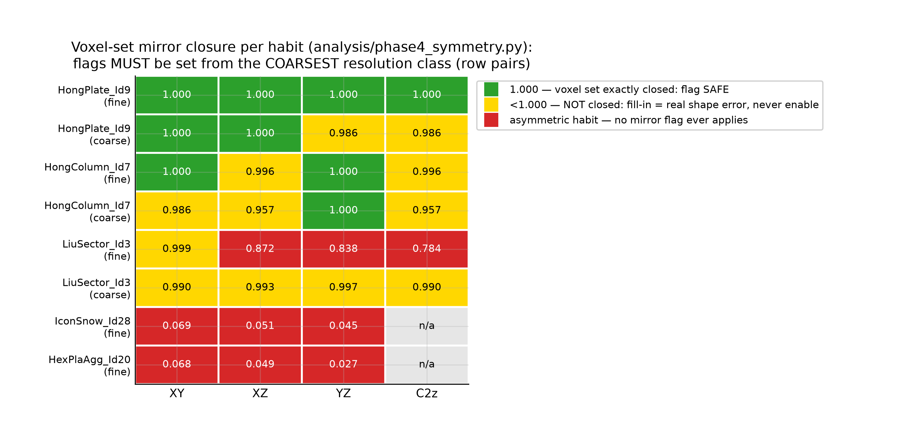

**Fig. 6 — the mirror-flag decision table (traffic-light = the rule itself).** *Green: voxel
set exactly closed (1.000) at that resolution → flag may be enabled. Amber: <1.000 → the
fill-in would reconstruct voxels that do not exist = a real SHAPE error, never enable —
note how a mirror can be closed at fine resolution but broken at the coarsest class, which
is why flags follow the coarsest row of each pair. Red: habit intrinsically asymmetric.*

Production flags (report §4.7): **HongPlate_Id9 + TOR grid: XY+XZ=true, YZ=false**;
**HongColumn_Id7: YZ=true**; LiuSector/Icon/HexPlaAgg: none (aggregate/snowflake shapes
break all mirrors). Measured effect (§4.8):

| habit | solves | wall |
|---|---|---|
| ellipsoid gate (3 mirrors) | 162 $\to$ **27** (+135 fills) | 3.0$\times$ |
| HongPlate_Id9 (XY+XZ) | 642 $\to$ **177** (+465 fills) | 1.73$\times$ |
| HongColumn_Id7 (YZ) | 642 $\to$ **337** (+305 fills) | 1.39$\times$ |

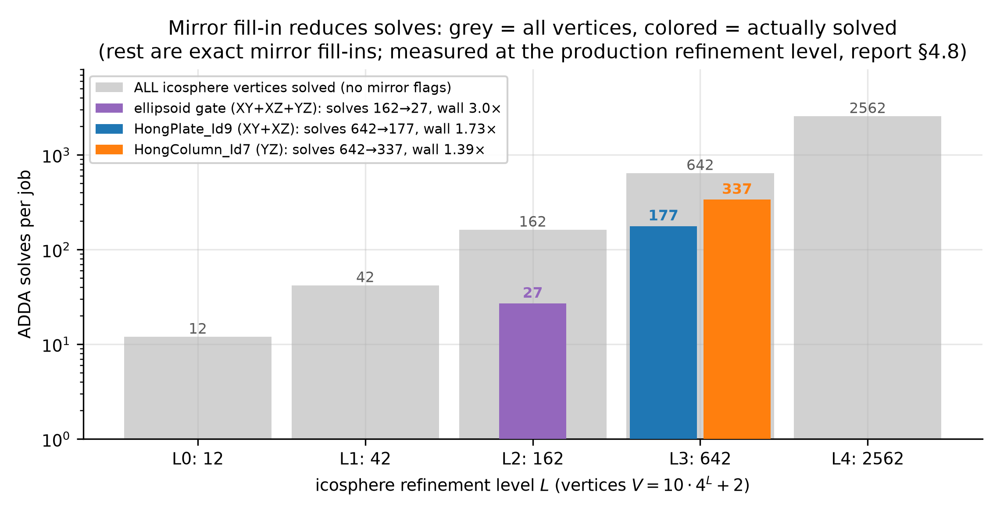

**Fig. 5 — what mirror fill-in buys (measured).** *Grey bars: every icosphere vertex solved
(no flags). Colored bars: actual ADDA solves with the habit's flags at that level — the rest
of the vertices are exact mirror fill-ins (still SH-expanded + cached, hence the wall-time
gain in the legend is smaller than the solve-count ratio).*

Wall gain is below the solve-count ratio at probe size because the per-*vertex* work
(SH expansion + cache write) still happens for fills; at production $x\approx10$ the ADDA solve
dominates and the ratio closes. `sym_Zobj` ($C_n$ rotation) is parked: exact $C_{2z}$ itself is
resolution-dependent (HongPlate: 1.000 fine / 0.986 coarse), and the cube-lattice model
never realizes ideal $C_6$ exactly; XY+XZ fill-in already implies exact $C_{2x}$ anyway.

## 1.8 What the SSDB export contains

Post-processing turns the per-job store into ARTS-SSDB NetCDF — the format of
the published ARTS Microwave SSP Database, whose TRO generation is documented in
**Eriksson et al. (2018, ESSD 10, 1301–1326)**; the ARO extension of that format is
documented in **Brath et al. (2020, AMT 13, 2309–2333)**. Our writer version is
**`beta_0.9.1`** (Phase-6 additive backscatter variables; the 7 parallel variable lists
all grow in lockstep). One file per
**( $\beta$, size, f, T)** under a nested tree:

```
<adda_results>/SSD/Azimuthally_random/ice/Aggregate/Pristine/HongPlate_Id9/
    AzimuthallyRandom_beta090deg/
        Dmax00019um_Dveq00017um_Mass1.086e-11kg/
            Freq166.900GHz_T270K.nc
```

Physically meaningful content per file (all spectral, units $\mathrm{m}^{2}$):

- `phaMat_data_real/imag` — phase-matrix spherical-harmonic coefficients,
  dims (16 Mueller elems $\times$ 1 az-inc $\times$ 19 za_inc $\times$ n_sph_coeffs);
- `extMat_data` — extinction-matrix elements (K11, K12, K33) on the (az, za_inc) grid;
- `absVec_data` — absorption vector (2 elems), computed as $C_{\mathrm{ext}}-C_{\mathrm{sca}}$ from the
  spectra, with a **negative-a1 rescale diagnostic** (§3.3);
- **`backMat_data` + `backMat_index`** (Phase 6) — the orientation-averaged exact-backscatter
  Mueller matrix, m²/sr, dims (phaMatElem × aa_inc × za_inc); `backMat_index` is the fixed
  identity pairing like `phaMat_index`. This is the *spectrally independent* backscatter
  value (not reconstructed from the phase matrix, §1.4 item 3); NaN-filled for stores that
  predate Phase 6;
- `ShapeData` scalars: diameters, mass, dpl, N_dipoles, refractive index (real/imag),
  plus provenance attrs (`refrIndex_model='Maetzler2006'`, habit id/name, source file);
- `CalculationData` attrs (provenance of the run): ADDA version, cluster, n_cores,
  `ADDA_eps`, `Refinement_delta`, `Mueller_sph_eps`, `Phase_sph_eps`, symmetry flags,
  shtns version.

The derived quantities consumers usually want (C_ext, SSA, asymmetry parameter g) are
**not** stored — they are computed downstream by the published-DB tooling
(`arts-sspdb-interface/`). Full variable table: Appendix C.

## 1.9 Analytic diffraction-peak model + residual storage (Phase 9A — scanned, not yet in the pipeline)

*Status: scanned and gated end-to-end (2026-11-09, `analysis/phase9_fwdmodel_scan.py`,
plan `plans/forward_peak_plan.md`, report §9) — **no pipeline code changed**. This section
develops the idea the way a textbook would: §1.9.1 fixes the amplitude language, §1.9.2
derives why a large particle must have a narrow forward peak, §1.9.3 turns the peak width
into a spectral-order budget, §1.9.4 presents the model/residual split, §1.9.5 derives the
model itself and its validity conditions, §1.9.6 reports the measurements, and §1.9.7 the
verdict.*

### 1.9.1 The language: scattering amplitude, Mueller matrix, optical theorem

Everything below speaks in terms of the **complex far-field amplitude**. With $k=2\pi/\lambda_0$
the scattered field of one solve is written, in the usual far-field notation,

$$
  \mathbf E_{\text{sc}}(\mathbf r)
  \;=\; \frac{e^{ikr}}{r}\;f(\hat n)\;\mathbf E_{\text{inc}}^0\,,
  \qquad \hat n = \mathbf r/r ,
  \tag{1.9.1}
$$

where $f$ is the $2\times2$ amplitude (Jones) matrix in the local scattering basis. This is
exactly the object the pipeline already parses: the columns of ADDA's `ampl_scatgrid` are the
Bohren–Huffman (BH) elements $s_1..s_4$ under the standard $k\,f$ normalization (§1.4). The
measured quantity is the **Mueller matrix**, a *quadratic* function of the amplitude,

$$
  M(\hat n) \;=\; f(\hat n)\otimes f^{*}(\hat n)
  \quad(\text{Stokes bilinear form}),
  \tag{1.9.2}
$$

which is what gets expanded in spherical harmonics and stored (§1.6). The third player is the
**optical theorem**, which extracts extinction from the amplitude *linearly*:

$$
  C_{\mathrm{ext}} \;=\; \frac{4\pi}{k}\;
  \mathrm{Im}\bigl[\hat s^{\dagger}\, f(\hat s)\, \hat s\bigr],
  \tag{1.9.3}
$$

where $\hat s$ is the propagation direction of the incident beam — Eq. (1.9.3) is precisely the
Mishchenko construction behind `acf.extinction_matrix` (§1.4). Note the contrast that will
control everything in §1.9.4: **$M$ is quadratic in $f$, $C_{\mathrm{ext}}$ is linear in $f$.**

Two limiting regimes of $f(\hat n)$:

- **Rayleigh regime** ($x=\pi D_{veq}/\lambda_0\ll1$): the particle is a driven dipole;
  $|f|^2\propto\cos^2\theta$ per polarization channel — smooth, **no spike** anywhere.
  (An early note in this manual claimed the forward peak "dominates at very small $x$" —
  wrong; the Phase-9A plan corrected the framing.)
- **Geometric regime** ($x\gg1$): the pattern is dominated by a narrow **diffraction peak**
  around $\hat n=\hat s$. Production runs live at $x\le10$, i.e. between the regimes —
  where the peak is real but only moderately narrow, and *exactly* what sets the angular
  sampling cost (Fig. 13a shows the transition for exact-Mie spheres: no spike at $x=1$,
  a 4-decade spike at $x=10$).

### 1.9.2 The extinction paradox and the diffraction peak (Babinet)

Classical result (van de Hulst; B&H): for $x\to\infty$ the extinction cross section of *any*
particle tends to **twice its geometric projected area $G$**: $C_{\mathrm{ext}}\to 2G$. Pure
ray tracing through the particle removes only $G$ — the geometric shadow — so where does the
other half come from? Babinet's principle answers: the shadow behind the particle must be
dark, which requires a field *radiated by the particle silhouette* that is exactly
$\mathbf E^0_{\text{inc}}$ out of phase there — and any field that cancels the incident wave
at $\hat n=\hat s$ must, by conservation, reappear as coherent scattering *into* the forward
direction. For a silhouette (aperture) $A$ with eikonal amplitude transmittance
$e^{i\Delta(\rho)}$, $\Delta=k(m-1)\ell(\rho)$, the diffracted amplitude is, up to a sign
convention fixed by the §1.9.5 anchor,

$$
  f_{\text{diff}}(\hat n) \;=\; \frac{ik}{2\pi}
  \iint_{A}\bigl[1-e^{i\Delta(\rho)}\bigr]\,
  e^{-ik\hat n\cdot\rho}\;d^{2}\rho\,.
  \tag{1.9.4}
$$

Insert the black-screen limit ($1-e^{i\Delta}=1$) into the optical theorem (1.9.3):
$f_{\text{diff}}(\hat s)=ikA/2\pi$ gives $C_{\text{ext,diff}}=(4\pi/k)(kA/2\pi)=2A$ —
a perfectly black screen of area $A$ extinguishes $2A$: the paradox, and with it the statement
that **the forward peak alone carries $C_{\mathrm{ext}}\to2G$**.

Fourier duality fixes the peak's width. An aperture of projected radius $a_\perp$ radiates
into a cone of half-angle

$$
  \sin\theta_1 \;=\; 1.22\,\frac{\lambda_0}{2a_\perp}
  \;=\;0.61\,\frac{\lambda_0}{a_\perp}
  \quad(\text{first Airy zero}),
  \tag{1.9.5}
$$

so the peak narrows like $\lambda_0/D$: for a sphere ($a_\perp=D_{veq}/2$,
$x=\pi D_{veq}/\lambda_0$) the first minimum sits at $\theta_1\approx 220°/x$ — verified in
Fig. 13b (the dashed rings at $44°$ for $x=5$, $22°$ for $x=10$). The sidelobes beyond the
peak are set by the *projected silhouette*, not by $D_{veq}$ — for plate habits the silhouette
changes strongly with orientation, which is why the peak structure is orientation-dependent.

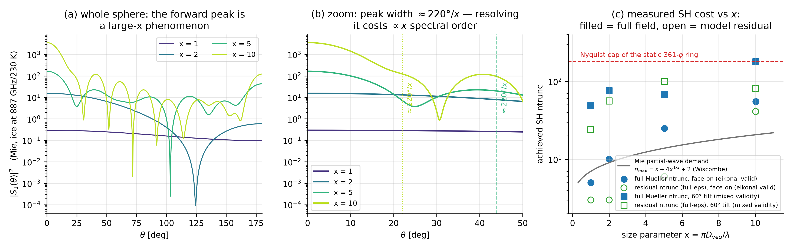

**Fig. 13 — why the diffraction peak is the cost driver.** *(a) exact-Mie $|S_1|^2$ over the
whole sphere for four size parameters — the spike appears only at large $x$; (b) zoom on
0–50°: the peak width shrinks like $220°/x$; (c) achieved SH truncation order per production
cell vs $x$: filled blue markers = today's full-field cost (grows like the grey Wiscombe
curve and saturates at the red Nyquist cap), open green markers = what a model+residual
split would need instead. Data: `analysis/phase9_results.json`.*

### 1.9.3 What the peak costs: the band-limit argument ($n_{\text{trunc}}\propto x$)

Spherical harmonics up to degree $n$ form a **band-limited function space on the sphere**:
they cannot represent angular structure finer than

$$
  \Delta\theta_{\min} \;\approx\; \frac{\pi}{n}\ \text{rad}
  \;=\;\frac{180°}{n}\ \text{deg}
  \qquad(\text{equivalently a }2n{+}1\text{-point }\varphi\text{-ring, the Phase-8 Nyquist rule §1.6.1}).
  \tag{1.9.6}
$$

Therefore resolving a peak of width $\theta_1\propto1/x$ *requires*, for any numerical method,

$$
  n_{\text{trunc}} \;\gtrsim\; \frac{\pi}{\theta_1} \;\propto\; x\,.
  \tag{1.9.7}
$$

The rigorous version of the same law for spheres is the Mie partial-wave demand —
$n_{\max}=x+4x^{1/3}+2$ (Wiscombe; the $x^{1/3}$ term is the edge/"creeping-ray" boundary
layer) — and it is the same law the Phase-8 grid budgets use (§1.6.1). The measured
per-vertex ntrunc of the production pipeline follows it (Fig. 13c) and even **saturates the
static grid's Nyquist cap** (ntrunc 179 ≈ 180 = the cap of the 361-point $\varphi$-ring) at
$x=10$, tilted orientations.

Why this is a *cost* statement: the SH coefficient count per vertex scales $\propto n_{\text{trunc}}^2$
(storage in `mueller_data.nc`, per-vertex caches), as do the shtns analysis/synthesis and the
Wigner rotations of the orientation average (§1.5–1.6). **The diffraction peak is the single
biggest data/cost item at large $x$ — and (1.9.7) says numeric sampling of the peak can never
be made cheaper. The only remaining lever is to stop storing the peak numerically.**

### 1.9.4 The book-keeping: model the peak analytically, store only the residual

Radiative-transfer has long "renormalized" the forward peak away (the δ-Eddington / δ-M
trick: replace the peak by a delta function and preserve its lowest moments — at the cost of
angular resolution *inside* the peak). The Phase-9 idea does the opposite: keep the peak
**fully resolved**, but represent it by an analytic formula that is re-evaluated on demand,
and store numerically only the remainder. Formally, split the **amplitude** field

$$
  f(\hat n) \;=\; F_{\text{model}}(\hat n)\;+\;g(\hat n)
  \tag{1.9.8}
$$

with $F_{\text{model}}$ analytic (§1.9.5) and $g\equiv f-F_{\text{model}}$ the residual. Only
$g$ needs a grid and SH storage. Three structural facts make this safe — or dangerous, if
misapplied:

1. **The identity is exact by construction.** $g$ is *defined* as $f-F_{\text{model}}$, so
   $F_{\text{model}}+g\equiv f$ regardless of the model's quality. The model's own error is
   never part of the error budget; it only determines *how smooth and small* $g$ is. A bad
   model degrades gracefully ($g\approx f$, zero savings) — **unless** it makes $g$ rougher
   or larger than $f$, which is exactly the failure mode measured in §1.9.6.
2. **The split must happen at amplitude level, not Mueller level.** By (1.9.2),

   $$
   M[f] \;=\; M[F_{\text{model}}] \;+\; M[g] \;+\; 2\,\mathrm{Re}\bigl(F_{\text{model}}\otimes g^{*}\bigr).
   \tag{1.9.9}
   $$

   The cross-term is $\mathcal O(|F||g|)$ — near the peak, where $|F|$ is largest, it is
   comparable to $M[F_{\text{model}}]$ itself. Storing "$M - M[F_{\text{model}}]$" numerically
   would therefore require the consumer to carry $F$ anyway and would destroy the
   interference structure. Keeping $(F_{\text{model}},g)$ keeps everything algebraically exact.
3. **Extinction comes out of the same identity for free.** The optical theorem (1.9.3) is
   *linear* in $f$:

   $$
   C_{\mathrm{ext}}[f] \;=\; C_{\mathrm{ext}}[F_{\text{model}}]
   \;+\;\frac{4\pi}{k}\,\mathrm{Im}\bigl[\hat s^{\dagger} g(\hat s)\hat s\bigr],
   \tag{1.9.10}
   $$

   and $F_{\text{model}}(\hat s)$ is analytic — the forward-amplitude column of §1.4 survives
   the split.

The error rule follows immediately from fact 1: the reconstruction error is the SH truncation
error of $g$, an **absolute** quantity, so the residual's truncation target must be measured
against the *full field's* intensity scale,

$$
  \delta[g] \;\le\; \texttt{eps\_sphexp}\cdot\operatorname{RMS}(M_{11}^{\text{full field}})
  \qquad\text{not}\qquad
  \texttt{eps\_sphexp}\cdot\operatorname{RMS}(M_{11}^{g})\,.
  \tag{1.9.11}
$$

This "**full-eps**" rule is the single most consequential methodological finding of Phase 9A;
the historic own-eps rule (§1.6) silently misprices residuals — a worked example in §1.9.6.

### 1.9.5 The model itself: eikonal ray-march + analytic radiation

The model must exist for *arbitrary voxel habits at arbitrary orientations* (exact Mie exists
only for spheres), and it must be cheap and orientation-local. The construction has three
steps.

**Step 0 — an exact starting point.** For a particle of constant refractive index $m$, the
scattered far field is produced by the polarization current $\mathbf P=(m^2-1)\mathbf E$
*inside* the volume. Taking the far-field limit of the radiation integral gives an identity
with **no approximation at all**, provided the true internal total field is inserted:

$$
  f(\hat n) \;=\; \frac{k^{2}}{4\pi}\,(m^{2}-1)
  \iiint_{V}\frac{E_{\text{tot}}(\mathbf r)}{E_{\text{inc}}^0}\;
  e^{-ik\hat n\cdot\mathbf r}\;d^{3}r\,.
  \tag{1.9.12}
$$

(Complex amplitude shorthand; applied per polarization channel like (1.9.1).) This is the
standard "distorted-wave" representation: everything hard is hidden in $E_{\text{tot}}$.

**Step 1 — the eikonal approximation to $E_{\text{tot}}$.** Approximate the internal field by
a plane wave that accumulates the optical path along each incident straight ray: with foot
point $\boldsymbol\rho$ in the screen plane through the scatterer center perpendicular to the
incidence direction $\hat s$, arc length $s$ along the ray, and $\ell(\boldsymbol\rho)$ the
chord length through the *exact voxel set* on that ray,

$$
  \frac{E_{\text{tot}}}{E_{\text{inc}}^0}\;\approx\;
  \varphi(s) \;=\; e^{\,ik\left[s\,+\,(m-1)\,\ell(\boldsymbol\rho)\right]} .
  \tag{1.9.13}
$$

Single pass, straight rays: no refraction (bending), no internal reflection, no internal
multiple scattering. Crucially, $\ell(\boldsymbol\rho)$ is **ray-marched voxel-exactly from
the shipped `.adda` file** — the geometry enters without any fitted ellipsoid or screen-plane
shortcut, which is what makes the model habit-general.

**Step 2 — carry the ray integral into (1.9.12).** With $\mathbf r=\boldsymbol\rho+s\hat s$
and $\mu=\hat n\cdot\hat s=\cos\theta$ the volume integral factorizes into a screen integral
of a ray integral:

$$
  F_{\text{model}}(\hat n) \;=\; \frac{k^{2}}{4\pi}
  \iint e^{-ik\hat n\cdot\boldsymbol\rho}
  \left[\int\,(m^{2}-1)\,\varphi(s)\,e^{-ik\mu s}\,ds\right]d^{2}\rho\,.
  \tag{1.9.14}
$$

The bracket (the code's $G(\mu,\boldsymbol\rho)$, evaluated chunked over screen pixels so the
huge $(n_\mu\times n_\rho)$ matrix never materializes) is the *full-angle* form: replacing
$\mu\to0$ inside the bracket recovers textbook Fraunhofer diffraction at a phase-modulated
screen (the eikonal transmittance $e^{i\Delta}$ of (1.9.4) reappears; for small phase delay
$\psi$ (below) the two agree up to constants absorbed into the calibration). Keeping $\mu$
is what makes $F_{\text{model}}$ defined over the whole $4\pi$ grid rather than only a small
cone, degrading gracefully away from the forward direction. In the project's
$k\,f$-normalized ADDA convention the implementation evaluates the prefactor as
$k^{3}/4\pi$ — i.e. $S_{\text{model}}=k\,F_{\text{model}}$ — so it can be compared and
calibrated directly against the parsed `ampl_scatgrid` columns.

**One global calibration constant $c$.** Per run ($T$, $f$, size), a single complex number is
least-squares-fitted in *amplitude space* (never log space — the model's zeros poison log
fits) between $c\,F_{\text{model}}$ and the full ADDA grid. Physically $c$ absorbs the
local-field/depolarization correction that any distorted-wave ansatz misses: on a voxel
sphere at $x=0.3$ the fit returns $|c|=0.614$, close to the exact uniform internal-field
(Clausius–Mossotti) factor $3/(m^2+2)=0.582$; at production $x$ the eikonal limit is
asymptotically right and the anchors give $c=1.005-0.006j$ ($x=1.9$) / $1.008-0.011j$
($x=3.8$) — a $|c-1|<1\%$ agreement, cross-$x$ drift $0.55\%$.

**Why the conventions must be pinned first.** The cross-term in (1.9.9) has amplitude
$2|F||g|\cos(\text{phase slip})$: a phase slip of even a few mrad between the analytic model
and ADDA's grid rotates part of "$-F$" into "$+F$" and turns the subtraction into an
addition *precisely where the field is strongest*. The scan therefore anchors every
convention on the one shape where truth is analytic (sphere, exact Mie — triple-validated
scipy == mpmath == miepython == published Wiscombe MIEV0 case-14, $\le5\cdot10^{-16}$; the
B&H 5.12 log-derivative $D_n$ recurrence in `analysis/phase6_backscatter.py` is confirmed
correct, gotcha §D-24). Anchor results (G1, all PASS): ADDA's `ampl_scatgrid` columns = BH
$s_1..s_4$; ADDA's far-field phase origin = **scatterer center** (fitted offset $u_0=0.000$
lattice units — the earlier "bbox corner" hypothesis is dead); ADDA $C_{ext}$ vs analytic at
dpl 70 agrees to 0.23 % ($x=1.9$) / 1.33 % ($x=3.8$) — DDA discretization level; and a
Mueller grid rebuilt from the parsed amplitudes matches ADDA's own `mueller_scatgrid` to
$\le7.4\cdot10^{-11}$ (port check).

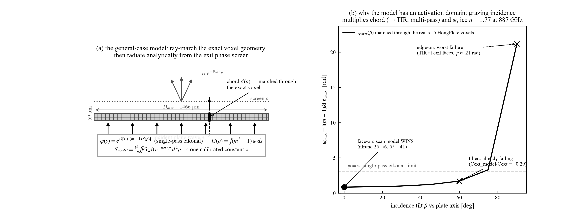

**Fig. 14 — the model: what it is, and the one knob that says when it works.** *(a) schematic
on the real x=5 HongPlate slab: march every ray through the exact voxels to get the chord
$\ell(\rho)$, radiate analytically from the exit screen; (b) the phase thickness
$\psi_{max}$ marched through the real voxels vs incidence tilt: below the green
$\psi=\pi$ line the single-pass eikonal picture is plausible, far above it (edge-on) the
model is guaranteed to fail. Ice refractive index at 887 GHz makes even a 541 µm plate
"optically thick" edge-on.*

**Validity conditions (textbook: van de Hulst / B&H, "diffraction approximation").** The
single-pass eikonal (1.9.13) is justified only if

- (a) **refraction is weak**, $|m-1|\ll1$ — *never* true for ice in the sub-mm ($n=1.77$ at
  887 GHz); for face-on plates refraction mainly perturbs chord geometry, and the scan shows
  empirically that the surviving error is tolerable there — but (a) failing is why the
  validity domain must be *measured*, not assumed;
- (b) **internal phase delay is modest**,

  $$
  \psi(\boldsymbol\rho) \;=\; \bigl|(m-1)\,k\,\ell(\boldsymbol\rho)\bigr| \;\lesssim\; \pi ,
  \tag{1.9.15}
  $$

  because once $\psi>\pi$, internally reflected / totally internally reflected multi-pass
  fields reorganize the exit field with interference structure that (1.9.13) cannot
  represent *at any calibration*;
- (c) the silhouette is well resolved — satisfied automatically (voxel-exact marching).

$\psi_{max}$ is computed for free by the same ray-march. Measured on the real $x=5$ HongPlate
voxels at 887 GHz (Fig. 14b): $\psi_{max}\approx0.7$ rad face-on, $\approx2$ rad at $60°$,
$\approx21$ rad edge-on — versus the $\pi$ single-pass limit: valid face-on, hopeless edge-on.

### 1.9.6 Measured: the winning domain and the failure domain (15-cell scan)

Scan design (plan §9A): `analysis/phase9_fwdmodel_scan.py`, ADDA 1.4.0 on the production
static $181\times361$ grid and the production command mirror (`-shape read`, `-eps 3`,
$\texttt{eq\_rad}=D/2$), Matzler ice at 230 K. Cells: HongPlate_Id9 at 887 GHz (the size
grid hits $x=1,2,5,10$ exactly: $D_{veq}=108/215/541/1078\;\mu$m) $\times$ orientations
{face-on, $60°$ tilt, edge-on} — the $x=1$ edge-on cell is skipped (sub-wavelength slab,
degenerate) — plus HongColumn_Id7 at $x=2$ and $x\approx4.9$ $\times$ {along-axis, $60°$}:
**15 cells**. Per cell: calibrate $c$; split (1.9.8); measure the residual fraction
$\lVert g\rVert/\lVert f\rVert$ (amplitude L2); re-expand the residual with the *production*
expansion rule (`expand_mueller_2_spharmonics`, `eps_sphexp=0.005`) under both the own-eps
and the full-eps criterion (1.9.11); sanity-check $C_{ext,\text{model}}/C_{ext,\text{ADDA}}$.
Full table: report §9.2 / `analysis/phase9_fwdmodel_table.txt`.

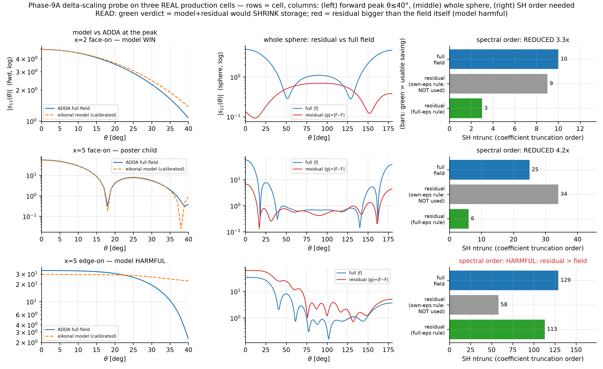

**Fig. 15 — the three verdicts, per real production cell (row = cell).** *Column 1: does the
calibrated model reproduce the forward peak? Column 2: whole sphere — blue = full field,
red = what would have to be stored after subtracting the model; if red exceeds blue
(edge-on row), the split makes storage WORSE. Column 3: SH order actually needed: green bar
(full-eps rule, Eq. 1.9.11) vs blue full-field bar — the grey own-eps bar is shown only to
expose how misleading that rule is (see the metric rules below).*

Three archetypes emerge (Fig. 15):

- **WIN — HongPlate face-on at every $x$.** The model captures the peak shape *including the
  Airy zeros*: residual fraction $|g|/|f|=0.03$–$0.31$, $C_{ext,\text{model}}/C_{ext}=1.05$–$1.15$.
  The full-eps residual ntrunc collapses: $5\to3$ ($x=1$), $10\to3$ ($x=2$), $25\to\mathbf{6}$
  ($x=5$ — coefficient count $\propto n^2$, i.e. a $\sim$40× smaller store), $55\to41$
  ($x=10$). Even the $60°$-tilted $x=10$ cell wins big: $179\to81$ — and the 179 there is the
  *grid-Nyquist-saturated* value (see the second rule below).
- **MARGINAL — small-angle deviations, tilted columns.** Intermediate cells (e.g. HongPlate
  $x=2$–$10$ at $60°$) shrink but less; the physics: $\psi$ grows with tilt (Fig. 14b) and
  the single-pass picture frays.
- **HARMFUL — grazing incidence.** Plate edge-on at $x=5$: $|g|/|f|=1.73$ — the residual is
  LARGER than the field (possible because $c$ is fitted over the full sphere; the model
  *adds* field the DDA does not have), and $C_{ext,\text{model}}=-0.44\,C_{ext}$ — negative,
  the unambiguous signature of a broken model (§1.9.5 condition (b): $\psi\approx21\gg\pi$,
  internal TIR + multi-pass interference ignored). The $60°$-tilted $x=5$ cell fails the same
  way ($|g|/|f|=1.21$, $C_{ext,\text{model}}=-0.29\times$), and so does the column along-beam
  cell at $x\approx4.9$ ($\psi\approx8.6$ rad, $C_{ext,\text{model}}=0.16\times$, fitted $|c|$
  collapses to $\approx0.14$ of the global value).

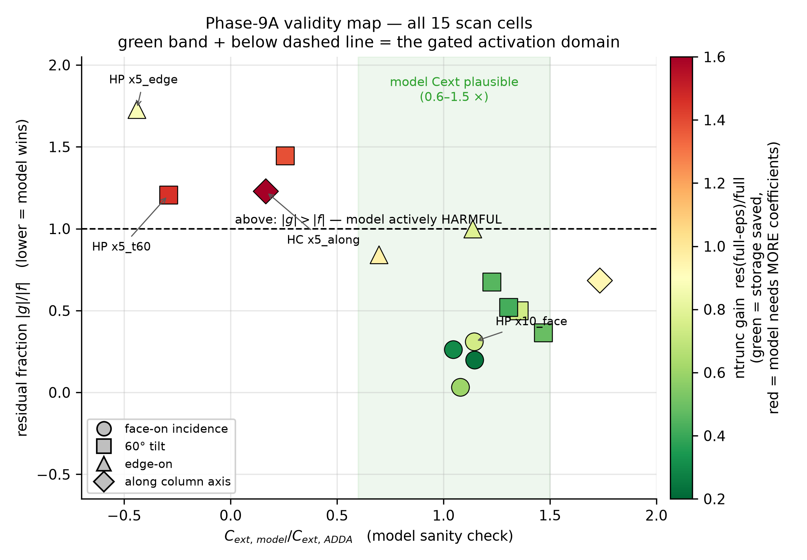

**Fig. 16 — the gated activation domain for all 15 scan cells at a glance.** *A cell is
usable only if it sits in the green band ($C_{ext,\text{model}}$ sane, 0.6–1.5×) AND below
the dashed line (residual smaller than the field). Colors: green = fewer SH coefficients
than today, red = the model would need MORE (harmful). Marker shape = incidence orientation
(legend bottom-left): every face-on cell is green, every tilted/edge-on cell drifts up and
right — hence "gated", not blanket.*

Crucially, **validity is measurable without the full field**, i.e. cheaply per solve: the
fitted calibration magnitude $\lvert c_{\text{fit}}/c_{\text{global}}\rvert$ deviates strongly
exactly in the broken cells (dev $>1.4$: $x=2$ edge 5.2, $x=5$ edge 6.4, $x=10$ edge 4.0,
HC $x=5$ along 0.14), and $C_{ext,\text{model}}\le0$ or $<0.5\times$ flags them independently.
Under the full-eps criterion, ntrunc is reduced in **10 of the 13 cells with $x\ge2$**
(ratios 0.24–0.96); all three losses are validity-broken cells.

Two metric rules decide all of these numbers (and any future hybrid must respect them):

- **full-eps vs own-eps** (Eq. 1.9.11): judging the residual against its OWN small $M_{11}$
  norm misprices it badly — e.g. the $x=1$ face cell: the residual's $M_{11}$ norm is only
  $3\%$ of the full field's, yet own-eps assigns the residual ntrunc **23**, worse than the
  full field's 5 (a $4.6\times$ "penalty"), while full-eps reads **3** (an actual $1.7\times$
  saving — and 23/3 = a $7.7\times$ overestimate of the residual cost). The rule of Eq. (1.9.11) is
  correct because the model is re-added exactly, so the residual's *absolute* truncation
  error rides on top of the full field for free;
- the $x=10$ t60 **full** field already sits at the static grid's Nyquist cap
  (179≈180) — full-field twins of large-$x$ runs are **grid-limited**, not
  expansion-limited (report §9.3), which bounds what any full-field comparison can show.

Backscatter: the model contributes nothing at $\theta=180°$ (its field is off by
$10^{-2}\dots8\times$, no consistent scale — the eikonal single-pass picture has no account
of the coherent retro-reflection): the Phase-6 exact `backMat_data` route (§1.4, §1.8) stays
mandatory and a hybrid would exempt that ring, as Brath et al. (2020) already flag the
exact-backscatter direction as unreliable in the SH route anyway.

### 1.9.7 Verdict and Phase-9B design consequences

**Conditional GO — a per-cell *gated* hybrid, not a blanket subtraction.** The validity
domain of §1.9.5–1.9.6 is real but orientation-dependent, and §1.9.6 showed it is detectable
from cheap per-solve observables. Design sketch (report §9.4): per (vertex, β) decision from
$c$-fit consistency, the $C_{ext,\text{model}}>0$ sanity band, and the $\psi$ bound
(1.9.15) — deciding model+residual vs plain full field; mixed runs store the per-cell flag
in the nc metadata; `rawdata2average` reconstructs $f=F_{\text{model}}+g$ on load.

Where the payoff lands, in the language of §1.9.3:

- **Internal cost (the target):** the per-vertex expansion/storage $\propto n_{\text{trunc}}^2$
  collapses in qualifying cells (e.g. the ntrunc 179→81 class, which dominates the
  orientation-expansion refinement at large $x$). The ADDA *solve* itself is untouched
  (the scat grid is far-field post-processing), and the grid laws of §1.6.1 could relax for
  qualifying vertices.
- **SSDB format: NO-GO for now** — with a clean textbook reason: shipping $F_{\text{model}}$
  as SH coefficients would require the model's OWN high-$n_{\text{trunc}}$ tail, which *is*
  the expensive content (1.9.7): the saving exists only if the consumer receives the model
  *descriptor* (chord map + $c$) and evaluates (1.9.14) itself — a format change plus
  ARTS/RTTOV-side implementation; Phase-8.8 export caps already deliver 15× without any of
  that.
- Before building it, 9B must benchmark against a plain adaptive-eps re-balance (no model) —
  Phase-8's laws already capture part of the same trend.

---

# Part 2 — Architecture & data flow

## 2.1 ARO call graph (production path)

Verified call graph (report §1.1, line numbers re-verified against current files):

*Solve phase* (one job per T, f, size):

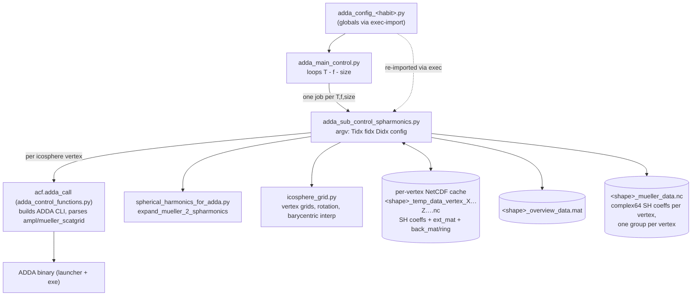

*Post-processing phase* (run later, per habit — see §3.3):

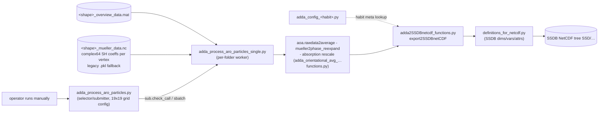

## 2.2 TRO call graph

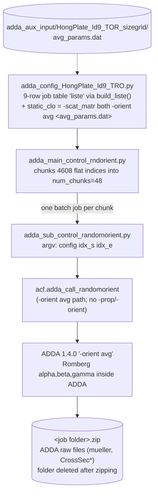

Gotchas specific to TRO (all verified): the mistral batch branch of
`adda_call_randomorient` raises `NotImplementedError` (never was implemented — now loud
instead of a swallowed NameError); there is **no completion-skip logic** (every listed
index is re-run); `liste` **row 8 must carry the temperature** (9-row format) or the
folder gets named with the flat index as `T####K` (a loud warning guards this legacy
path); `deq` in the folder name receives the equivalent **radius** (legacy naming).

## 2.3 Artifact data flow (what lives where, what is transient)

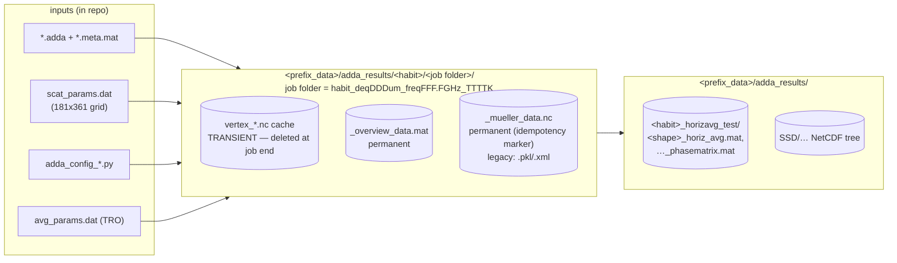

Idempotency layers (ARO): **(1)** job-level — main control skips a (T,f,size) if the
folder contains at least one `*mueller_data.{xml,pkl,nc}` and `force_new=False`;
**(2)** vertex-level NetCDF cache (survives a killed/restarted *job*, deleted only when
the job completes); **(3)** within a refinement pass, vertices identical to the previous
icosphere level reuse cached expansions without touching ADDA.
TRO has **none** — plan reruns accordingly.

The final per-run Mueller store `<shape>_mueller_data.nc` (Phase 7) is one file per
(T, f, size): one group per *computed* icosphere vertex (name = temp-cache
`vertex_X…` id), holding the complex64 SH coefficients (`mueller_sph`, stored losslessly
as float32 pairs), `relerror`, `ext_mat`, `back_mat`, and the explicit `sph_l`/`sph_m`
coefficient-index arrays; the group attr **`vertex_index` is the sole ordering key** (never
trust group iteration order). Written atomically (`.tmp` + `os.replace`). Legacy `.pkl`
stores are still readable (deprecation warning; migrate with
`analysis/migrate_pkl_to_nc.py`); legacy `.xml` is not readable anymore. Vertex-cache
stores that predate Phase 6 lack `back_mat` — both cache-check sites then treat them as a
**cache miss** and re-run ADDA, so a resumed old store can never silently yield NaN back
data (full schema: report §7.1).

## 2.4 Module status table

| module | role | status |
|---|---|---|
| `adda_main_control.py`, `adda_sub_control_spharmonics.py` | ARO driver + per-job solver | **active** |
| `adda_main_control_rndorient.py`, `adda_sub_control_randomorient.py`, `acf.adda_call_randomorient` | TRO driver (`-orient avg`) | **active** (Phase-3 repaired) |
| `adda_control_functions.py` (acf) | ADDA CLI wrapper, Matzler dielectric, Romberg helpers, mirror transforms, NetCDF cache, MATLAB reader | **active** |
| `spherical_harmonics_for_adda.py` (spha), `icosphere_grid.py` (ico) | SH machinery, orientation grids | **active** |
| `adda_orientational_avg_spharmonics_functions.py` (aoa) | post-processing averaging / phase-matrix re-expansion | **active** |
| `adda_process_aro_particles[.py/_single.py]`, `adda2SSDBnetcdf_functions.py`, `definitions_for_netcdf.py` | post-processing + SSDB export | **active** (export gated behind env `SSDB_EXPORT_NETCDF=1`) |
| `adda_sub_control_gridref.py`, `acf.romberg_alpha/gamma`, `adda_orientational_avg_spharmonics_for_testing.py` | old grid-refinement experiment | **deprecated — do not extend** |
| `posix_spawn.py` | fast process spawn (Linux ctypes; macOS subprocess branch) | active helper |
| `memory.py`, `sbatch_adda` | legacy helpers | dormant |
| `old_configs/`, `SSD_scripts_deprecated/`, `NetCDF_export_testscript*.py` | archives / one-off test scripts | **archive — never import** |

---

# Part 3 — Operations & runbooks

## 3.1 The config contract

Every habit has one `adda_config_<habit>.py`; the control scripts inject it with
`exec('from adda_config_X import *')` and read its globals. **Keep field names** when
copying a config — the drivers `getattr`-probe them. The canonical reference is
`adda_config_HongPlate_Id9.py`. Annotated field → consumer map:

| config global | meaning | consumed by |
|---|---|---|
| `calc_type` (`'mistral'`/`'thunder'`/`'local'`) | host mode; **`local` = Phase-3 no-queue macOS branch** (repo-relative paths, direct `sub.check_call`) | both main controls, sub-controls, export provenance |
| `prefix`, `prefix_data`, `main_path`, `ramdrive` | storage roots (local: repo-relative; `ramdrive=None` → system temp) | sub-controls (job folders, ADDA `-dir`) |
| `adda_prefix`, `cluster_name` | ADDA checkout root; SSDB provenance string | export `CalculationData` |
| **`adda_binary`, `adda_launcher`, `adda_version`** | ADDA executable triple; env overrides `ADDA_BINARY`/`ADDA_VERSION` apply on top; sub-controls fall back to 1.2 defaults if a config lacks these | both sub-controls via `main_command = launcher + [binary]` |
| `shape_name`, `shape_foldername`, `shape_path`, `subpath`, `shapelist`, `shape_str` | habit + geometry file list (`shape_str=[]` $\Rightarrow$ `-shape read <file>` is prepended) | main/sub controls, export meta lookup |
| `Sizes`, `Dmax`, `fmin` (arrays parallel to `.mat` files) | physical size grid + resolution classes (read from `*.meta.mat` with `acf.loadmat`) | job loops + selection rule |
| `frequencies` (Hz), `temperatures` (K) | the production channel set (35 channels 1–886 GHz $\times$ 3 T for HongPlate) | job loop; dielectric evaluation |
| `size_parameter_limit` (=10) | x-cap | main control skip |
| `number_of_betas` (=5), `incidence_angles` (10 vals) | ARO **output** coordinate resolution during solve-averaging (post-processing re-grids to 19$\times $19) | sub-control averaging stage |
| `delta` (=0.01), `limit_sph` (=4) | icosphere orientation convergence / max level | sub-control refinement loop |
| `eps` (=3) | ADDA solver residual exponent | `acf.adda_call -eps` |
| `eps_sphexp` (=0.005) | per-vertex Mueller SH truncation target | `spha.expand_mueller_2_spharmonics` |
| `sym_XYobj`, `sym_XZobj`, `sym_YZobj` | **mirror fill-in flags — must be set from the coarsest resolution class** (§1.7, `analysis/phase4_symmetry.py`) | sub-control skip/fill logic; export provenance |
| `alpha_0/beta_0/gamma_0` (0/0/0) | base particle attitude handed to `-orient` | sub-control |
| `force_new` (False) | recompute even if completed-marker exists | main control idempotency |
| `ZIPPING` (False) | keep per-vertex ADDA output in zips (auto-deleted if False) | `acf.adda_call` |
| `scat_param_path`, `static_clo` | ADDA static flags: `-store_scat_grid -scat_grid_inp <scat_params.dat> -scat_matr both` (`-Csca`/`-alldir_inp` removed — never parsed) | `acf.adda_call` |
| TRO only: `liste` (9 rows!), `num_chunks`, `batch_time`, `avg_param_path` | flat job table (rows: shape, **eq radius m**, eps, m_re, m_im, $\lambda$ m, shape file, batch time, **T K**) + chunking + avg file | rndorient pair |
| HPC: `ncores`, `Partition` | Slurm sizing | sbatch wrappers |

## 3.2 ARO job flowcharts

### Driver: `adda_main_control.py`

Part 1 — startup and the nested loops:

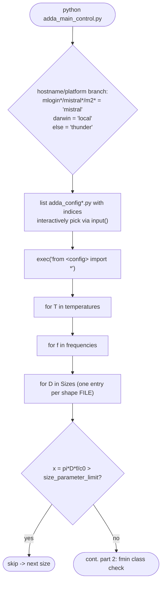

Part 2 — resolution-class selection, idempotency check, dispatch:

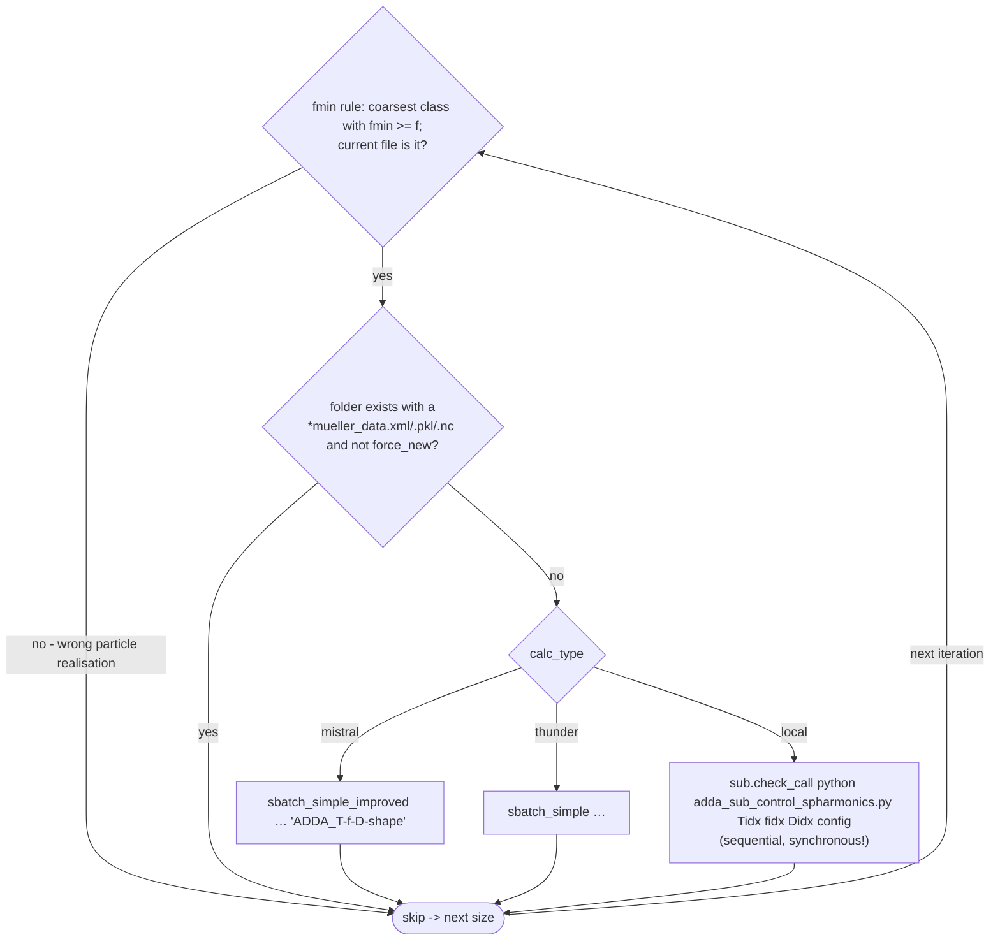

> ⚠ local mode runs thousands of jobs **synchronously in one foreground process**.
> For anything beyond smoke tests, deselect sizes/frequencies in a probe config or run
> the vertex loop in parallel (see §3.6).

### One job: `adda_sub_control_spharmonics.py` (per T, f, size)

Part 1 — init and the icosphere vertex loop, per refinement level *L* = 0… (min 3 passes,
max `limit_sph` = 4):

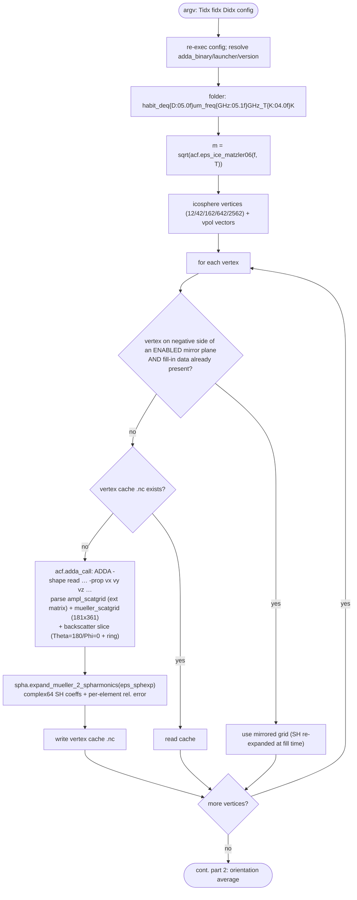

Part 2 — orientation average, refinement loop, outputs:

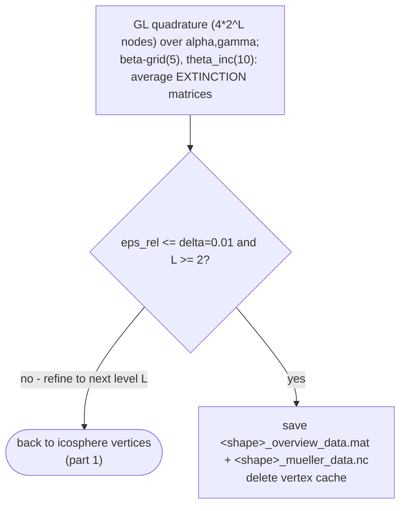

The mirror-fill transform ( $\varphi$ remap + Stokes signs + SH re-expansion) is sketched in
§1.7; the same vertex grid also answers `interpolation_weights_icosahedric_grid` queries
during the averaging stage — barycentric interpolation, `aoa.pol_changer` for the Stokes
polarization basis.

## 3.3 Post-processing: folder → SSDB NetCDF

Run by hand per habit (or per folder) — this is deliberately decoupled from the solves:

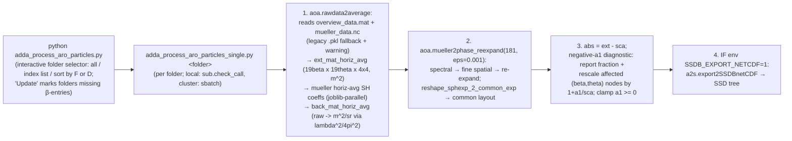

Notes: the 19$\times $19 ( $\beta$, $\theta_{\mathrm{inc}}$) grid and `eps_phase=0.001` are **hard-coded** in
`adda_process_aro_particles.py:74–107` (independent of the solve-time 5$\times $10); the SSDB
export is **off by default** (`SSDB_EXPORT_NETCDF=1` to enable); the habit processed is
env-selected `SSDB_HABIT=<habit>` (default `HexPlaAggCrystal_Id20`). The negative-a1
rescale is a physical-consistency repair: where the spectral C_sca exceeds C_ext the
whole phase matrix at that node is scaled down; check the printed diagnostics — a large
`frac_of_neg_a1` means the truncation error `eps_sphexp/eps_phase` is fighting you.

## 3.4 TRO production run

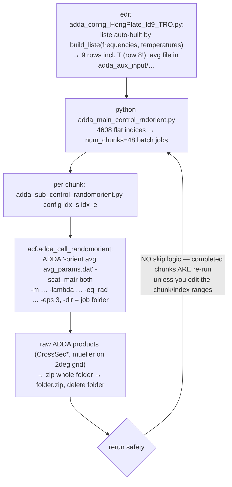

Gate artifacts kept in `analysis/`: `phase5_tro_beta_gate.py/.log` ( $\beta$-fold equivalence),
`phase5_tro_probe.log` (ADDA accepts the avg files in 1.2/1.4/1.5).

## 3.5 Local (macOS) runbook

**Python env** — mamba env `DDA` (py3.12): conda-forge `numpy scipy netcdf4 joblib
matplotlib fftw pkg-config`; pip `typhon==0.10.0 shtns` (shtns: no osx-arm64 conda
build; native wheel — rebuild with `pip install --no-build-isolation --no-deps shtns`
while fftw+pkg-config are present). Never downgrade typhon (0.8.0 is broken on 3.12;
`ty.arts.xml` is gone — Mueller artifacts are NetCDF4 `*_mueller_data.nc`, Phase 7).

**ADDA build** (works identically for `adda_1.2`, `adda_1.4`, `adda/`; never run the
checked-in Linux ELF binaries under `adda_1.2/src/`):

```sh
cd adda_1.4/src && make cleanseq                 # stale Linux .d files break make otherwise
make seq "OPTIONS=NO_FORTRAN" \
  FFTW3_INC_PATH=$CONDA_PREFIX/../envs/DDA/include \
  FFTW3_LIB_PATH=$CONDA_PREFIX/../envs/DDA/lib
# make links WITHOUT rpath → relink with rpath so dyld finds libfftw3.3.dylib:
cd seq && gcc -o adda *.o -L<env>/lib -Wl,-rpath,<env>/lib -lm -lfftw3
```

(NO_FORTRAN is fine: only IGT/surface modes need Fortran; the pipeline uses `-int defint`
default.)

**Running a smoke job locally**:

```sh
mamba activate DDA
cd adda_python_scripts
python adda_main_control.py            # pick the config index when prompted
# cross-version experiments without editing configs:
ADDA_BINARY=../adda_1.4/src/seq/adda ADDA_VERSION=1.4.0 python adda_main_control.py
```

The config `local` branch maps `prefix`→`adda_python_scripts/`, `prefix_data`→repo root,
so results appear under `./adda_results/…`. Keep probes small: one config with 1 T,
1–2 frequencies, 1–2 sizes (see `adda_config_phase*_…py` for probe patterns).
`force_new=True` forces recompute; otherwise completed jobs are skipped.

## 3.6 HPC runbook (Mistral / Thunder)

- Config hostname branch sets prefixes (`/work/um0878/…`, `/scratch/uni/u237/…`),
  `ramdrive=/dev/shm…`, Slurm `Partition`, `ncores`; submission goes through the
  site-specific `sbatch_simple*` wrappers (paths hard-coded in the main controls).
- Cluster configs still default to **ADDA 1.2 MPI** (`adda_1.2/src/mpi/adda_mpi` via
  `srun -n N`); the production decision is **1.4.0** — build an MPI 1.4 binary on the
  cluster and flip the triple, or export `ADDA_BINARY`/`ADDA_VERSION`.
- **Parallel job structure (Phase-4b recommendation, report §4b.3):** the per-vertex ADDA
  solves are process-level parallel and single-core-efficient — pool *N_cores* single-core
  `adda` invocations inside each (T,f,size) job rather than one MPI-parallel solve; keep
  the adaptive icosphere refinement sequential (it is a decision loop, not a loop nest).
- Cost anchors for planning: see §4.4 backlog table and `fig07`; the 1.4/1.5 trees also
  accept the old CLI subset unchanged (report §1.3 compatibility audit) except the
  `-orient avg` + grid-flag conflict (§1.5.5).

---

# Part 4 — Validation & quality gates

## 4.1 Golden baselines (`baselines/`)

The frozen regression reference: 6 ADDA cases mirroring the exact CLI pattern of
`acf.adda_call` (`-orient 0 0 0`, `-prop 1 0 0`, `-eps 3`, Matzler ice at 230 K):
sphere (independent Mie check), oblate ellipsoids x=0.1/1/5, HongPlate_Id9 Dveq10 $\mu$m at
192/337 GHz. Current golden: **`baselines/adda_1.4.0/`** (regenerated 2026-11-06);
`adda_1.2/` archived for provenance. Case results, Mie validation and scattering-pattern
figures: **Appendix E**; narrative report: `baselines/REPORT.md`.

```sh
python baselines/make_baseline.py --adda <adda-seq-binary> --out baselines/<tag>
python baselines/check_baselines.py baselines/<tag>     # analytic sanity (sphere/Mie etc.)
```

**The gate rule is noise-based, never bit-level.** Measured ADDA re-run scatter of
*identical commands* at `-eps 3`: 0.0 for four of six cases, $\le 10^{-11}$ generally,
but **$8.3\cdot10^{-4}$ for the $x=5$ case** (12 312 dipoles at residual $10^{-3}$).
Therefore regression tolerances are: $10^{-10}$ for small cases, $5\cdot10^{-3}$ for
$x=5$. Any stack change (numpy/scipy bump,
ADDA switch, symmetry fill-in) must land inside those bands. Do not regenerate goldens
casually; a new golden requires re-deriving the noise budget.

## 4.2 Equivalence suites (what was proven, and how)

| gate | command / artifact | result |
|---|---|---|
| Phase-2 numpy-2 migration | `analysis/phase2_equiv.py` (pre/post pickles) | pipeline bit-identical on numpy 2 / py3.12 / macOS |
| ADDA 1.2 vs 1.4.0 vs 1.5.0-alpha3 | `analysis/phase3_equiv.py`, `phase3_results.json` | ext rel-diff $3\cdot 10^{-17}$…$2.5\cdot 10^{-4}$, mueller $\le5\cdot 10^{-4}$ (all below the $5\cdot 10^{-3}$ noise bound; x5 numbers *below 1.2's own scatter*); auto dipole density identical across versions; TRO `-orient avg` CrossSec **bit-identical** → **production binary: 1.4.0** |
| mirror machinery (sym vs asym, same config otherwise) | `analysis/phase4_subcontrol_gate.log`, `phase4_aoa_gate.log` | identical within $4.5\cdot 10^{-12}$ with *closed* mirrors; a non-closed mirror (coarse YZ, closure 0.986) produces $1.5\cdot 10^{-4}$ field errors — proof the closure gate is load-bearing |
| half-range $\beta$/$\theta$ reuse hypothesis | `phase4b_halfrange_check.py/.log` | **rejected**:$2.3\cdot 10^{-3}$…$7.2\cdot 10^{-2}$ discrepancy vs $10^{-11}$ noise |
| TRO $\beta$-fold (0–90° avg file vs full range) | `phase5_tro_beta_gate.py/.log` | CrossSec $\le1.35\cdot 10^{-5}$ (= Romberg tol), Mueller $\le10^{-13}$ → PASS |
| ADDA cost/accuracy | `phase4b_adda_benchmark.py`, `…_bench_results.json` | fig. 04; error budget discretization-dominated |
| backscatter matrix (Phase 6) | `analysis/phase6_backscatter.py`, `phase6_results.json` | Mie pole agreement + convention pin + mirror-ring rule + SSDB backMat round-trip — all PASS |
| Mueller artifact → NetCDF4 (Phase 7) | `analysis/mueller_nc_roundtrip_check.py` (20/20), `analysis/mueller_nc_gate.py` (W/X/R/E gates) | nc round-trip **bitwise** lossless; probe run + double-reader (`nc` vs legacy `pkl`) averaged dicts, phase chain and 5-file SSDB export (125 vars) **bit-identical**; 12/12 local `.pkl` artifacts migrated + bitwise-verified |
| analytic-grid twin (Phase 8) | `analysis/phase8_scatgrid_twin.py`, `phase8_endtoend_twin.py`, `phase8_export_twin.py` | adaptive vs static grid: all PASS (margin ≥4); full-pipeline 22×42 vs 181×361 twin: d_ext $7.6\cdot10^{-16}$, d_sph $1.9\cdot10^{-3}$; export cap keeps content bitwise, **15×** smaller beta files |
| forward-peak convention anchor (Phase 9A) | `analysis/phase9_fwdmodel_scan.py` (G1), `phase9_results.json` | Mie triple-anchor ≤$5\cdot10^{-16}$; ADDA Cext vs analytic 0.23%/1.33% at dpl 70; calibration c=1.005/1.008 (cross-x dev 0.55%); far-field origin = scatterer center (0.000 lattice); port check ≤$7.4\cdot10^{-11}$ |

Harness lessons that produced *false* failures — remember them when writing new gates:
auto dpl is **quantized** (a $10^{-8}$ $\lambda$ typo changes N_dipoles and breaks comparisons —
compute $\lambda$/eq_rad exactly like `make_baseline.py`), and a scalar `theta=90.0` emits
`z=6.12e-17` instead of exact `-prop 1 0 0`, rotating the $\varphi$ reference (up to $2\cdot 10^{-2}$ Mueller
difference at x=5 — use the vector branch). Third trap (report §8.8/§9.2): *relative*
per-element gate metrics explode on cancellation channels — Rayleigh-limit Mueller
channels are pure noise; gate against the cell's physical intensity scale plus the
store's measured noise plateau.

## 4.3 Where the accuracy lives (error budget recap)

$$
\varepsilon_{\mathrm{total}} \;\approx\;
\underbrace{\varepsilon_{\mathrm{disc}}}_{\text{fmin class}/dpl_{\mathrm{eff}}}\;+\;
\underbrace{\varepsilon_{\mathrm{orient}}}_{\delta=0.01,\ \ge 3\ \text{levels}}\;+\;
\underbrace{\varepsilon_{\mathrm{SH}}}_{\texttt{eps\_sphexp}=0.005,\ \text{phase}:10^{-3}}\;+\;
\underbrace{\varepsilon_{\mathrm{solver}}}_{\texttt{-eps }3:\ 10^{-11}\ldots 8\cdot10^{-4}}\;+\;
\underbrace{\varepsilon_{\mathrm{fp}}}_{\text{float32/complex64}}
$$

with the **discretization term dominant** (design margin $\ge 10^{-3}$).

If a consumer complains about smoothness/positivity (negative absorption vector a1),
look at the SH truncation terms and the rescale diagnostics (§3.3), not at ADDA.

## 4.4 Production backlog (as of Phase 5)

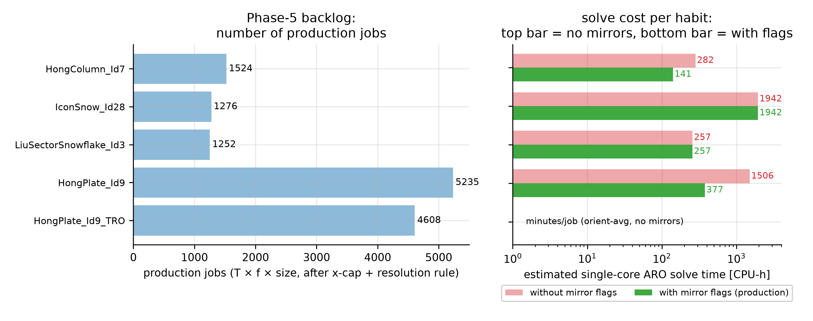

**Fig. 7 — size and cost of the remaining production backlog.** *Left: jobs per habit
(each job = one (T, f, size), already after the x-cap and the resolution rule of Figs. 2–3).
Right: estimated single-core solve time — the gap between the red and green bars is what the
mirror flags (§1.7) save; habits without usable mirrors (Icon/Liu) show no gap. TRO is cheap
by construction (`-orient avg` inside ADDA).*

| config | jobs | mirrors | est. single-core solve-time |
|---|---|---|---|
| HongPlate_Id9 (ARO, full 35-ch grid) | 5235 | XY+XZ (25 % solves) | 377 CPU-h (unmirrored: 1506) |
| HongColumn_Id7 | 1524 | YZ (50 %) | 141 CPU-h (282) |
| IconSnow_Id28 | 1276 | none | 1942 CPU-h |
| LiuSectorSnowflake_Id3 | 1252 | none | 257 CPU-h |
| HongPlate_Id9_TRO | 4608 | ( $\beta$-folded avg) | minutes per job |

$\approx$ **2700 single-core CPU-h** total. Runbook: local mode only for probes; production goes
through the sbatch path with 1.4.0-MPI once built on the cluster (§3.6); ARO
post-processing/export per §3.3. Inventory reproducibility:
`analysis/phase5_backlog_inventory.py` (prints the table above and re-derives the job
list with the exact control-selection logic).

### Known open items (from report Phase 5, §5.7)

- Cluster MPI build of ADDA 1.4 (until then cluster runs use 1.2 defaults).
- TRO SSDB export path (currently `-orient avg` output is raw ADDA zips; a parser →
  NetCDF step is still to be specified).
- `sym_Zobj` parked (§1.7); half-range reuse rejected; GL-node $\beta$/$\theta$ grids rejected
  (no solves saved) — do not reopen without new evidence.

---

# Appendix A — ADDA command-line tokens used

Full assembled command lines (verified from `acf.adda_call` / the TRO pair):

**ARO solve** (per icosphere vertex):

```
[launcher] <adda_binary> -shape read <file.adda> \
    -store_scat_grid -scat_grid_inp <scat_params.dat> -scat_matr both \
    -m <Re(m)> <Im(m)>  -lambda <µm>  -eq_rad <µm, equivalent-volume RADIUS> \
    -orient <α0> <β0> <γ0>   -prop <vx vy vz (icosphere vertex unit vector)> \
    -dir <tmpdir>/temp  -eps <3>
```

**TRO solve** (per (f, size, T) — orientation averaging inside ADDA):

```
[launcher] <adda_binary> -shape read <file.adda> \
    -scat_matr both  -orient avg <avg_params.dat> \
    -m … -lambda … -eq_rad …  -dir <job folder>  -eps <3>
```

| token | note |
|---|---|
| `-eq_rad` | equivalent-volume radius ( $\mu$m) — `Sizes` holds *diameter*, the sub-control halves it; N_dipoles comes from the shape file, ADDA only rescales |
| `-orient α β γ` | zyz Euler degrees (production 0 0 0); the *beam* direction comes from `-prop` |
| `-prop` | incidence unit vector; **always pass the vector branch** (a scalar 90° emits z=$6.12\cdot 10^{-17}$ and rotates the $\varphi$ reference) |
| `-store_scat_grid -scat_grid_inp` | 181$\times $361° grid from `scat_params.dat` |
| `-scat_matr both` | amplitude + Mueller on the grid |
| `-eps 3` | residual $10^{-3}$; noise floor §1.1 |
| removed from configs | `-Csca`, `-alldir_inp` (never parsed; 1.4/1.5 flag-combination traps) |
| version caveat | `-orient avg` cannot combine with `-scat_grid`/`-Csca`/`-alldir` in 1.4/1.5 |

Parsing contract: `ampl_scatgrid` 1 header line, forward row first, column order
s22, s11, s12, s21 (pairs real/imag); `mueller_scatgrid` 1 header line, cols $\theta$, $\varphi$, then
16 elements row-major — **all positional**, re-verify on any ADDA upgrade.
The Phase-6 backscatter slice needs **no extra CLI token**: it is the Θ=180° row ×
Φ=0° column (plus the full Φ ring) of `mueller_scatgrid`; `acf.adda_call` raises if the
scat grid (Appendix B) lacks a Θ=180° row or Φ=0° column — the production 181×361 grid has both.

# Appendix B — the .dat input files

**`scat_params.dat`** (`adda_python_scripts/`, handed via `-scat_grid_inp`): `global_type=grid`,
$\theta$ range N=181 (0–180°), $\varphi$ range N=361 (0–360°) — 1° resolution; the `phi_integr` section
belongs to ADDA's internal integration (unused by us since `-Csca` was removed).

**`avg_params.dat`** (`adda_aux_input/<habit>/`, TRO): per-Euler-angle Romberg spec
`min/max/Jmin/Jmax/eps/equiv/periodic` (zyz). Production file for the TOR grid folds
**$\beta$ to 0–90°** using the XY-mirror closure (equivalence-gated $\le1.35\cdot 10^{-5}$, §1.5.5); the
full-range twin `avg_params_fullrange.dat` exists as the gate reference. Rule of thumb
from the file comments: axysymmetrical particles → `gamma max=0`; equivalence planes →
fold the range.

# Appendix C — SSDB NetCDF layout

Filename: `Freq{f:08.3f}GHz_T{T:03.0f}K.nc`, one per ( $\beta$, size, f, T), under
`SSD/<orientation_type>/<medium>/<crystal_type>/<pristine_type>/<habit>/AzimuthallyRandom_beta{β:03.0f}deg/<Dmax…Dveq…Mass…>/`;
root attrs `date`, `version='beta_0.9.1'` (Phase-6 additive backscatter bump; the schema
below is otherwise the `beta_0.9` format of Brath et al. 2020); groups
`SingleScatteringData`, `ShapeData`, `CalculationData`.

| dimension | length | meaning |
|---|---|---|
| `sph_coeffs_scat` | common SH layout size | number of shtns coefficients of the phase-matrix re-expansion |
| `aa_inc` | 1 | azimuth of incidence (fixed 0°) |
| `za_inc` | 19 | zenith incidence-angle axis (°) |
| `phaMatElem` / `extMatElem` / `absVecElem` | 16 / 3 / 2 | element selectors (ext: K11, K12, K33; abs: 2 elems) |
| `scatMat_row`/`scatMat_Col` | 4 / 4 | Stokes matrix indices |

`SingleScatteringData` variables: `frequency` (Hz), `temperature` (K), `za_inc`, `aa_inc`,
index maps, **`phaMat_data_real` + `phaMat_data_imag`** (float32, $\mathrm{m}^{2}$, zlib; dims
phaMatElem $\times$aa_inc $\times$za_inc $\times$sph_coeffs_scat), `extMat_data` ( $\mathrm{m}^{2}$), `absVec_data` ( $\mathrm{m}^{2}$),
**`backMat_data`** (float32, m²/sr, dims phaMatElem × aa_inc × za_inc) and **`backMat_index`**
(int8, 4×4 fixed identity pairing) — the Phase-6 exact-backscatter matrix, stored
independently of the phase-matrix spectra (§1.4 item 3).

`ShapeData` (0-d): `diameter_max`, `diameter_vol_eq`, `diameter_area_eq_aerodynamical`,
`mass`, `dpl`, `N_dipoles`, `refrIndex_real/imag`, `alpha`, `beta`, `gamma` + attrs
(`shape_file`, `refrIndex_model='Maetzler2006'`, `habit_id`, `medium`, …).

`CalculationData` (attrs): `method='DDA'`, `software='ADDA'`, `software_version`,
`system`, `n_cores`, `date_completion`, `ADDA_eps`, `ADDA_scatParam_file`,
`ADDA_avgParam_file`, `Refinement_delta`, `Maximum allowed refinement level`,
`Mueller_sph_eps`, `Phase_sph_eps`, `sym_XYobj/XZobj/YZobj`, shtns version string.
Missing config keys degrade to `'n/a'` (`getattr(ac, …, 'n/a')`) — never crash the export.

# Appendix D — Gotcha catalog

Numbered for reference; several carry the bug-fix that neutralized them.

1. **Linux ELF binaries in `adda_1.2/src/seq|mpi`** — cluster-built, run nowhere locally. Always rebuild (`make seq`, NO_FORTRAN + FFTW rpath, §3.5); `make cleanseq` first or stale Linux `.d` files abort the build.
2. **Output parsing is positional** (`ampl_scatgrid` col order s22,s11,s12,s21!) — re-verify on ADDA upgrades.
3. **ADDA reruns are not bit-reproducible** at `-eps 3` (up to $8.3\cdot 10^{-4}$ at x=5) → all gates noise-based.
4. **`-orient avg` + `-scat_grid`/`-Csca`/`-alldir` rejected** by ADDA 1.4/1.5.
5. **typhon must stay 0.10.0**; `ty.arts.xml` is gone — internal Mueller artifacts are **NetCDF4** (`*_mueller_data.nc`, schema in report §7.1; `rawdata2average` falls back to legacy `.pkl` with a deprecation warning); idempotency check accepts `.nc` plus legacy `.xml`/`.pkl` names.
6. **shtns on osx-arm64**: conda-forge has no build; rebuild wheel in-env (`--no-build-isolation --no-deps`) against the env's fftw.
7. **numpy-2 migration done** (Phase 2): `np.nan`, `np.complex128`, `trapezoid`, `np.tile`; `posix_spawn.py` has a macOS subprocess branch. Never reintroduce old aliases.
8. **Config globals are exec-injected** — renaming a config global breaks the drivers silently; keep the field contract (§3.1).
9. **Deprecated, do not extend**: `adda_sub_control_gridref.py`, `acf.romberg_*`, `adda_orientational_avg_spharmonics_for_testing.py`, `old_configs/`, `SSD_scripts_deprecated/`.
10. **TRO `liste` must have 9 rows** (row 8 = temperature). With 8 rows the folder name gets the flat index as `T####K` — now guarded by a loud warning; rebuild old-style configs instead.
11. **TRO has no idempotency**: chunk ranges are re-run unconditionally; TRO `deq` folder field is the eq **radius** (legacy).
12. **Mirror flags from the coarsest class only**; closure <1.000 fill-in = real shape error (~$1.5\cdot 10^{-4}$), not noise. Re-run `analysis/phase4_symmetry.py` when adding or regenerating shape files.
13. **f < 192 GHz in the frequency list runs** (coarsest class, grossly over-resolved) — the `=np.array([5,])*1e9` stub configs are pointless work, and `analysis/inventory.py`'s per-file rule counts them as zero (mismatch with the live control's behavior at low f — report §1.7 wording refers to the replica).
14. **`-prop` scalar vs vector branch**: always pass the unit vector (scalar 90° $\Rightarrow$ z=$6.12\cdot 10^{-17}$ $\Rightarrow$ $\varphi$-reference rotation $\Rightarrow2\cdot 10^{-2}$ Mueller artifacts in comparisons).
15. **`export2SSDBnetCDF` is off by default** (`SSDB_EXPORT_NETCDF=1`) and habit-selected by `SSDB_HABIT`; the 19$\times $19 grid + `eps_phase=0.001` are hard-coded in `adda_process_aro_particles.py`.
16. **Local mode is synchronous** — `adda_main_control.py` on the Mac runs jobs one-by-one in the foreground; use probe configs, and pool single-core ADDA solves if you parallelize (§3.6).
17. **Per-size class availability is not guaranteed complete** (e.g. HexPlaAgg 197 $\mu$m lacks the 192/337/457 classes); and for small particles the five classes are degenerate copies (identical N_dipoles).
18. **Vertex-cache is transient**: `<shape>_temp_data_vertex_*.nc` deleted at job completion; killing a job mid-way leaves it (useful), completing wipes it (startover of a *single vertex* re-solves).
19. **ZIPPING=False** silently deletes the auto-created vertex zip (ADDA raw output is not kept); set `ZIPPING=True` when debugging a solve.
20. **No version control was present historically** — repo is a git checkout now; still: results/intermediates live outside the repo (`adda_results/…`), and old HPC results are unrecoverable.
21. **Phase-6 backscatter data**: the raw `back_matrix`/`back_mat_ring` are **k-normalized** (dimensionless) — never treat them as µm²/sr before the `rawdata2average` $\lambda^2/4\pi^2$ conversion. Vertex caches / overview mats predating Phase 6 carry no back keys → treated as cache misses (forced ADDA re-runs); `rawdata2average` on old stores warns and leaves `backMat` NaN. The $B$-matrix polarization convention is $R(+\varphi)$ on **both** sides — using the extinction branch's $-\varphi$ is wrong (gate floor 3e-2 vs 0.96 error).
22. **Near-pole phase-matrix off-diagonals carry a few-% pole-interpolation artifact** (pipeline `mueller2phase`, known): if a consumer cross-checks `backMat` vs `phaMat($180°-\theta_{\mathrm{inc}}$)`, expect that floor — `backMat` at the exact point is the cleaner value (report §6.5).
23. **netCDF4 raises `IndexError` (not `KeyError`) for missing variables** — the cache readers catch both; a pre-Phase-6 store previously crashed `read_data_from_netcdf` (caught by the Phase-6 gate).
24. **Mie reference conventions (Phase 9A, pinned):** the B&H 5.12 log-derivative (D) form with *downward* recurrence (as in `analysis/phase6_backscatter.py`) is **validated** (== 40-digit mpmath == miepython == published Wiscombe MIEV0 case-14). Do **not** "fix" it with an explicit psi/chi/tau series replacing $D_n(mx)$ by $\tau_n'/\tau_n$ — that is not a valid B&H formula (gives negative Qext for lossy $m$; an earlier debug round chased it). Angular series: $\pi_n=-\mathrm{lpmv}(1,n,\mu)/\sin\theta$ (scipy lpmv carries the CS phase), $\tau_n=n(n+1)P_n(\mu)-\mu\pi_n$, pole limits $\pi_n(\pm1)=\pm n(n+1)/2$ signed.
25. **own-eps SH ntrunc is misleading for hybrid/residual products** (relative tolerance on a small field): judge residuals at the FULL-field M11 scale (report §9.2). Log-space convention fits are poisoned by model zeros — fit in amplitude space.
26. **ADDA far-field phase origin = scatterer center** (fitted lattice offset 0.000, Phase 9A G1) — analytic-model ports must center on the scatterer, not the voxel-box corner (the `mueller_scatgrid`-vs-ampl port check at ≤7e-11 confirms the rest of the frame port).
27. **Size-grid shape globs are 4-digit zero-padded** (`Dveq01078um`, not `Dveq1078um`) — a bare-number glob silently matches nothing (or worse, the wrong class).
28. **At $x\gtrsim10$ the full-field SH content saturates the static grid's Nyquist cap** (ntrunc 179 ≈ 180 on the 361-$\varphi$ ring): large-$x$ full-field twins are grid-limited, not expansion-limited (report §9.3).

# Appendix E — Baseline simulation results

The frozen regression set behind §4.1: six ADDA runs mirroring the exact CLI of
`acf.adda_call` (`-orient 0 0 0`, `-prop 1 0 0`, `-eps 3`, Matzler-2006 ice) — three
analytic/analytic-voxel sphere & spheroid cases at $x$ = 0.31/0.1/1/5 plus two
HongPlate_Id9 (D_veq = 10 µm) production-pattern cases. Current golden:
**`baselines/adda_1.4.0/`**; `baselines/adda_1.2/` is the archived provenance set —
the figures below are rendered from the 1.2 outputs, but Phase-3 equivalence (§4.2)
proves the 1.4.0 goldens agree within the noise bands. Full narrative:
`baselines/REPORT.md`.

## E.1 Headline numbers (frozen 1.2 outputs)

Cross sections from `CrossSec-X/Y`; ω = Csca/Cext with Csca from the (then-production)
`-alldir_inp` Romberg integration — note today's ARO configs no longer request `-alldir_inp`
(§1.4), these baselines predate that cleanup.

| Case | x | N dipoles | dpl (λ) | Qext (X / Y) | ω (X / Y) |
|---|---|---|---|---|---|
| ice sphere, 300 GHz, 230 K | 0.314 | 2 176 | 160.7 | 6.914e-3 / 6.914e-3 | 0.684 / 0.684 |
| oblate spheroid c/a=0.5, 183 GHz, 253 K | 0.1 | 1 104 | 402.8 | 3.824e-4 / 7.533e-4 | 0.0814 / 0.0820 |
| oblate spheroid c/a=0.5, 183 GHz, 253 K | 1 | 1 104 | 40.3 | 2.630e-1 / 6.612e-1 | 0.957 / **1.003** |
| oblate spheroid c/a=0.5, 183 GHz, 253 K | 5 | 12 312 | **18.0** | 1.574 / 2.217 | **1.569 / 2.091** |
| HongPlate_ID9, Dveq=10 µm, 192 GHz, 230 K | 0.020 | 1 015 | 1947 | 6.516e-5 / 1.015e-4 | 9.19e-4 / 9.35e-4 |
| HongPlate_ID9, Dveq=10 µm, 337 GHz, 230 K | 0.035 | 1 015 | 1109 | 2.052e-4 / 3.195e-4 | 2.77e-3 / 2.82e-3 |

Consistency checks that pass: sphere Qext X ≡ Y to all printed digits (rotational
symmetry); every habit case shows the expected X-vs-Y polarization splitting; the two
Hong-plate runs differ only via m(f) and the Romberg grid, Qext scaling ≈ ×3.15 from
192→337 GHz (Rayleigh: Cext ∝ Im(m)·f — matches).

**Sphere vs. independent Mie theory** (Riccati-Bessel in `check_baselines.py`,
cross-checked against `miepython`):

| quantity | ADDA (auto grid) | Mie | deviation |
|---|---|---|---|
| Qext | 6.9144e-3 | 6.7929e-3 | +1.79 % |
| Qsca | 4.7310e-3 | 4.6539e-3 | +1.66 % |
| Qabs | 2.1865e-3 | 2.1390e-3 | +2.22 % |

All inside the 3 % acceptance band, and the deviation is *confirmed DDA discretization
error*: forcing `-dpl 320/800` converges Qext 6.914e-3 → 6.852e-3 → 6.819e-3 toward the
Mie value (fig. E-2). Cross-version: ADDA 1.2 vs 1.5.0-alpha3 identical Qext for the
sphere to 12 significant digits; cross-platform: the macOS arm64 rebuild of 1.5.0-alpha3
reproduces the Linux cluster numbers exactly.

**Caveats (report §4):** ω > 1 at x = 5 is unphysical — Csca exceeds Cext by 68 % at the
auto grid (18.0 dpl, outside LDR validity ≲6–10 dpl); the angular integration is fully
converged, so this is a dipole-grid artifact. The case remains a valid deterministic
*regression fingerprint*, but its absolute Csca/Qsca/ω are not physics references — the
same caution applies to production runs at the large-x end of the backlog (§4.3
discretization-dominant budget). The x=1 ω=1.0025 value is the same effect at 0.2 % —
keep it as a regression tripwire.

## E.2 Figures

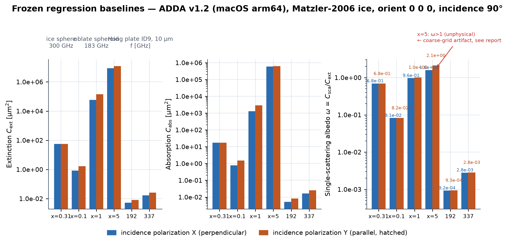

*E-1. Cross sections & albedo, X vs Y incidence polarization, all six cases.*

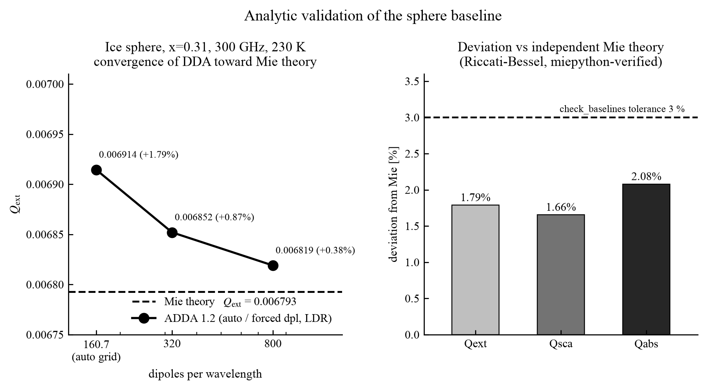

*E-2. Analytic validation: the sphere baseline converges toward independent Mie theory with dpl.*

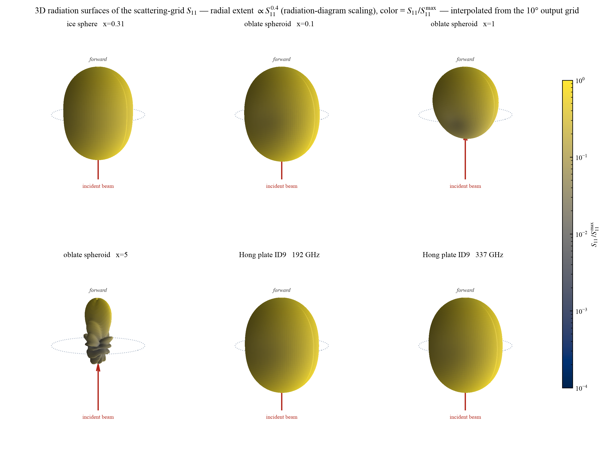

*E-3. 3-D radiation surfaces of the scattering-grid $S_{11}$ (radial extent ∝ $S_{11}^{0.4}$,
color = $S_{11}$/max, beam axis marked; interpolated from the 10° output grid). The
near-Rayleigh particles (sphere, x=0.1 spheroid, both Hong plates) are essentially
isotropic shells; x=1 develops diffraction rings; x=5 shows the classic narrow forward
spike with ringed side lobes.*

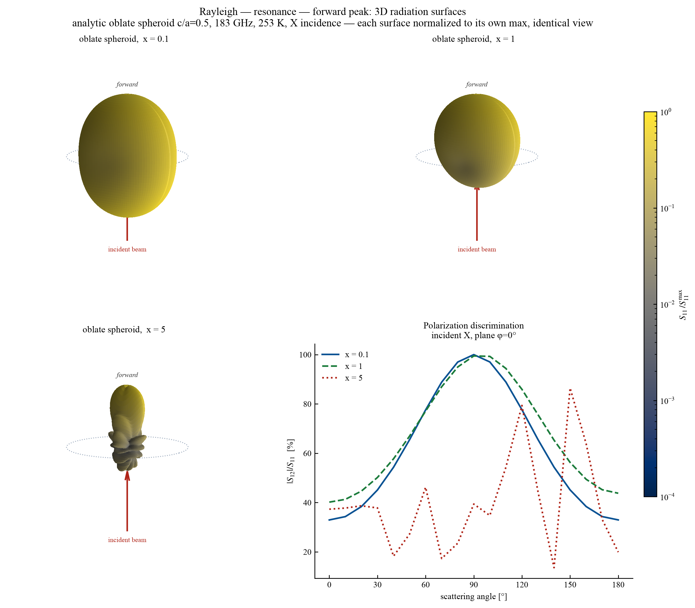

*E-4. Rayleigh → resonance → forward-peak evolution of the analytic oblate spheroid
(each surface normalized to its own max), plus polarization discrimination
$\lvert S_{12}\rvert/S_{11}$ in the φ=0 plane.*

## E.3 Reproduce

```sh
mamba activate DDA
python baselines/plot_baseline_figs.py      # figures (PNG 250 dpi + vector PDF, baselines/report/)
python baselines/check_baselines.py         # Mie consistency, exit code = pass/fail
python baselines/make_baseline.py --adda <binary> --out baselines/<tag>   # rerun cases
python docs/make_figures.py                 # mirrors the PNGs into docs/figures as fig09..fig12
```

# References

- **Brath, M., Ekelund, R., Eriksson, P., Lemke, O., Buehler, S. A. (2020)**: Microwave and
  submillimeter wave scattering of oriented ice particles, *Atmos. Meas. Tech.* **13**,
  2309–2333, https://doi.org/10.5194/amt-13-2309-2020. — **The main methodology article for
  everything ARO in this repo**: TRO/ARO definitions, zyz Euler angles, the ARO averaging
  approach (DDA solves + own orientation averaging over $\alpha,\gamma$), the
  ( $\beta$, $\theta_{\mathrm{inc}}$) output coordinates, and the RT motivation (ICI, GMI 166 GHz
  polarization). Their ARO database: zenodo 3463003.
- **Eriksson, P., Ekelund, R., Mendrok, J., Brath, M., Lemke, O., Buehler, S. A. (2018)**: A
  general database of hydrometeor single scattering properties at microwave and sub-millimetre
  wavelengths, *Earth Syst. Sci. Data* **10**, 1301–1326, https://doi.org/10.5194/essd-10-1301-2018.
  — The published ARTS SSPDB (TRO) paper: source of the habit-ID numbering and shape-file
  lineage (`*_Id<n>` folder names), the 35-channel frequency selection, the 190/230/270 K
  temperature set, the Mätzler-2006 refractive-index choice, and the SSDB NetCDF format the
  export targets (zenodo 1175572, tooling: `arts-sspdb-interface/`).
- Yurkin & Hoekstra 2011, *JQSRT* 112, 2234–2247 (ADDA); ADDA manual: `adda/doc/manual.pdf`, `adda_1.2/doc/manual.pdf`.
- **Bohren, C. F., Huffman, D. R. (1983)**: *Absorption and Scattering of Light by Small Particles*, Wiley. — cited as **BH** in this manual: source of the $s_1..s_4$ amplitude convention behind ADDA's `ampl_scatgrid` (§1.4, §1.9.1), the extinction paradox and diffraction-peak treatment (§1.9.2), and the validity conditions of the diffraction/eikonal approximations (§1.9.5).
- **van de Hulst, H. C. (1957)**: *Light Scattering by Small Particles*, Wiley. — classic derivation of the extinction paradox via Babinet's principle and of the exact internal-current representation underlying the Phase-9 model (§1.9.2, §1.9.5).
- **Wiscombe, W. J. (1979)**: Mie scattering as a function of particle size, in *Physical and Quantitative Aspects of Radiative Transfer: An Introduction to the Eleventh Symposium* (K. S. Shifrin, ed.), NASA SP-234. — partial-wave cutoff $n_{\max}=x+4x^{1/3}+2$ (§1.9.3); his MIEV0 reference cases anchor the Phase-9 Mie validation (§1.9.5).
- Mätzler 2006, dielectric function of ice (implemented in `acf.eps_ice_matzler06`).
- Mishchenko 2002 (*Light Scattering by Nonspherical Particles*) — extinction-matrix construction used in `acf.extinction_matrix`.
- ARTS Microwave SSP Database: https://doi.org/10.5281/zenodo.1175572 (browse/import tooling: `arts-sspdb-interface/`).
- Project working documents: `plans/DDA-modernization-plan.md` (approved plan), `plans/DDA-modernization-report.md` (findings per phase — **read before code changes**), `baselines/README.md`.

---

*Generated with the repo state of 2026-11-09 (figures redesigned for readability the same
day). Figures regenerate via `docs/make_figures.py` (Appendix-E baseline plots delegate to
`baselines/plot_baseline_figs.py`); this file plus `docs/DDA-manual.html` are produced from
the same source.*

